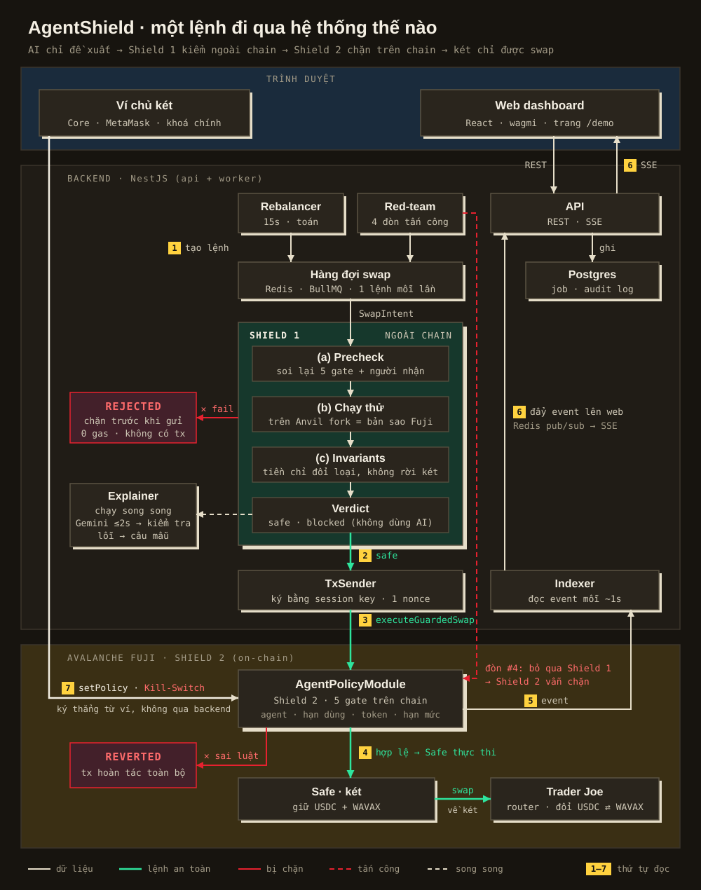

# AgentShield

Két Safe + module luật on-chain cho phép **AI agent giao dịch 24/7 mà không thể lấy tiền**. Chạy trên Avalanche Fuji · track "AI agents and security".

## Hệ thống chạy thế nào

  

**Đọc ảnh theo số:**

1. **Tạo lệnh.** Rebalancer tính bằng toán mỗi 15 giây (không dùng AI), hoặc Red-team bấm tấn công thử. Lệnh swap vào hàng đợi, chạy từng lệnh một.
2. **Shield 1, ngoài chain.** Auditor soi lại luật của contract, chạy thử lệnh trên bản sao của Fuji (Anvil fork), kiểm tra tiền không rời két, rồi kết luận bằng code. Fail thì lệnh bị `rejected`: không gửi tx, không tốn gas.
3. **Gửi tx.** Lệnh an toàn được TxSender ký bằng session key, khoá phụ của agent chỉ gọi được `executeGuardedSwap`.
4. **Shield 2, trên chain.** `AgentPolicyModule` kiểm 5 gate (đúng agent, còn hạn, token được phép, hạn mức mỗi lệnh, hạn mức ngày). Sai luật thì tx bị `reverted`. Hợp lệ thì Safe swap qua Trader Joe, tiền nhận về luôn là két.
5. **Đọc kết quả.** Indexer đọc event on-chain mỗi khoảng 1 giây.
6. **Lên web realtime.** Event đi qua Redis pub/sub, API, SSE tới web. Song song, Explainer nhờ Gemini (tối đa 2 giây) viết câu giải thích tiếng Việt; Gemini lỗi, chậm hoặc viết sai số thì dùng câu mẫu.
7. **Chủ két nắm quyền.** `setPolicy` và Kill-Switch được ký thẳng từ ví trên trình duyệt, không đi qua backend: backend sập vẫn khoá được agent.

Đường đỏ nét đứt là **đòn #4**: Red-team ký thẳng lên chain, bỏ qua Shield 1, và Shield 2 vẫn chặn (có link Snowtrace của tx revert). Đòn #3 (xin quyền rút vô hạn) gọi thẳng Safe và bị Safe từ chối với mã `GS104`.

**Vì sao agent không lấy được tiền:**

- **Shield 2 là lớp duy nhất được tin tuyệt đối.** Shield 1 chỉ giúp chặn sớm và không tốn gas; tắt nó đi thì Shield 2 vẫn chặn.
- **AI không có quyền.** Kết luận, số tiền và việc ký đều do code quyết định. Gemini chỉ viết câu giải thích, và câu đó cũng bị kiểm tra số trước khi hiển thị.
- **Chain là nguồn sự thật.** Hạn mức và số đã chi luôn đọc từ contract; Postgres chỉ lưu job và nhật ký kiểm tra.

## Cấu trúc repo

| Thư mục | Nội dung |
|---|---|
| `apps/web` | Dashboard: Vite + React 19 + wagmi/viem |
| `apps/server` | NestJS, 2 process: `api` (REST, SSE) và `worker` (Rebalancer, Auditor, Red-team, Indexer, Explainer) |
| `packages/shared` | Zod schema dùng chung, mã lỗi kèm câu tiếng Việt, tiện ích số tiền bigint |
| `packages/contracts` | `AgentPolicyModule`, factory (Foundry), đang làm |
| `infra` | Docker compose: Postgres, Redis, Anvil fork |
| `docs` | Tài liệu thiết kế, viết bằng tiếng Việt |

## Chạy thử

- **Windows, cả hệ thống:** chạy `start.bat` (cần Node ≥ 20 và Docker Desktop). Web ở http://localhost:5173, API ở http://localhost:4000.
- **Chỉ xem web:** `corepack pnpm install`, rồi `cd apps/web && corepack pnpm dev`.

Contract chưa deploy nên web hiện dùng dữ liệu mẫu. Chi tiết môi trường: [`docs/runbook/setup-and-bringup.md`](docs/runbook/setup-and-bringup.md).

## Đọc tiếp

| Bạn là | Đọc |
|---|---|
| Người mới vào nhóm | [`docs/onboarding/concepts.md`](docs/onboarding/concepts.md): khái niệm từ blockchain tới Shield 1/2 |
| Giám khảo, người nghe pitch | [`docs/product/pitch.md`](docs/product/pitch.md) |
| Người viết code | [`docs/architecture/system-design.md`](docs/architecture/system-design.md) (source of truth), [`docs/architecture/codebase.md`](docs/architecture/codebase.md) |
| Muốn xem hết tài liệu | [`docs/README.md`](docs/README.md) |
