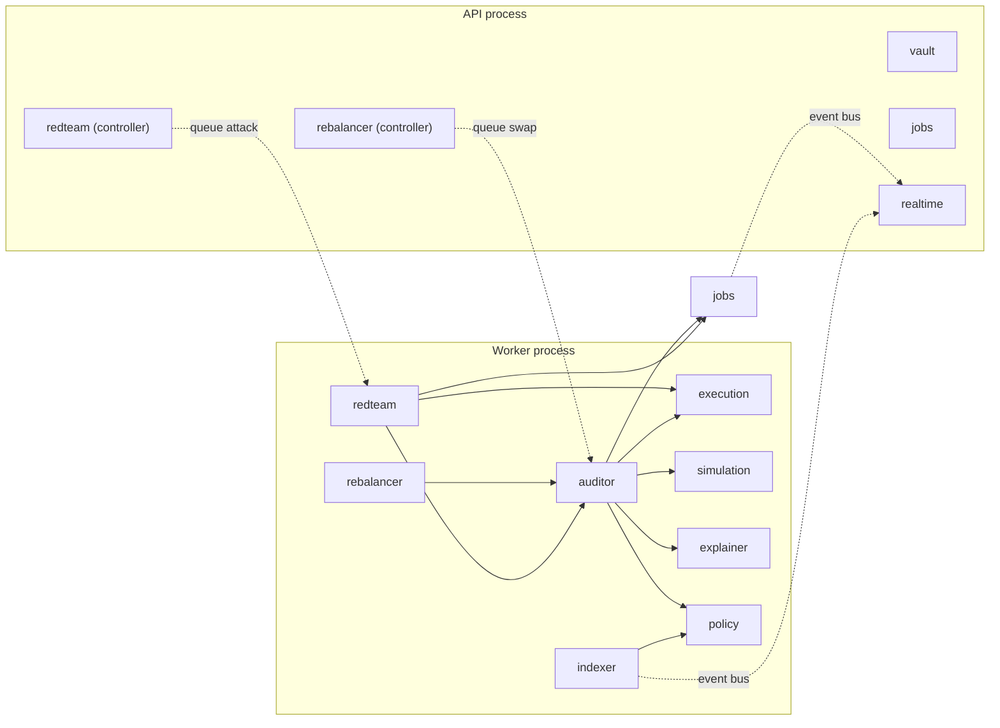
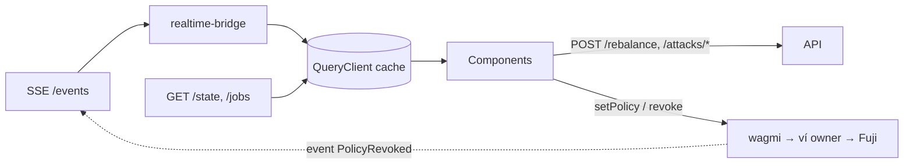

# 🧱 AgentShield — Codebase Architecture

> Đi kèm [`system-design.md`](./system-design.md). Tài liệu này trả lời: **chọn framework gì, kiến trúc code ra sao, folder như thế nào, ai code ở đâu.**

---

## 1. Tóm tắt quyết định

| Hạng mục | Chọn | Thay vì |
|---|---|---|
| Kiểu kiến trúc | **Modular monolith, 2 entrypoint (api + worker)** | Microservices, serverless, monolith phẳng |
| Bên trong module | **Hexagonal “lite”** — port/adapter chỉ ở biên hệ thống ngoài | Full Clean Architecture, layered phẳng |
| Repo | **Monorepo pnpm workspaces + Turborepo** | Polyrepo, Nx |
| Backend | **NestJS 11 + TypeScript** | Express, Fastify, Hono, FastAPI |
| Frontend | **Vite + React 19 SPA** | Next.js App Router |
| Hợp đồng giữa các phần | **`packages/shared`**: Zod schema + ABI sinh tự động | Copy-paste type, OpenAPI codegen |

---

## 2. Modular monolith có phù hợp không? → **Có, và là lựa chọn tốt nhất ở đây**

### 2.1 So sánh

| Kiến trúc | Ưu | Nhược với AgentShield | Kết luận |
|---|---|---|---|
| Monolith phẳng (Express 1 folder `routes/ services/`) | Nhanh nhất ngày 1 | Tuần 3 thành spaghetti; 3 người đụng cùng file; worker nặng chặn API | ❌ |
| **Microservices** (rebalancer-svc, auditor-svc, redteam-svc…) | Scale/deploy độc lập | 3 người phải lo network contract, service discovery, tracing, N Dockerfile; không có nhu cầu scale nào; thêm điểm hỏng khi demo | ❌ Over-engineering |
| **Serverless** (Next API routes / Vercel Functions) | Deploy dễ | Không chạy được worker dài hạn, repeat job 15s, SSE ổn định, kết nối Anvil | ❌ Sai runtime |
| **Modular monolith, 2 entrypoint** | 1 codebase, ranh giới module rõ, share type; tách *process* api/worker mà không tách *service* | Cần kỷ luật ranh giới (giải quyết bằng Nest module + lint rule) | ✅ |

### 2.2 “2 entrypoint” nghĩa là gì?
Cùng một codebase `apps/server`, build ra **một image**, chạy **2 lệnh**:
- `node dist/main.api.js` → HTTP (REST, SSE, Bull Board). Nhẹ, luôn phản hồi.
- `node dist/main.worker.js` → BullMQ processors, scheduler, indexer. Không mở cổng HTTP.

Hai process **dùng chung module** (ví dụ `JobsModule`, `ChainModule`) nhưng mỗi process chỉ import những module nó cần. Đây là điểm “sweet spot”: được lợi ích cô lập tải của microservices mà không phải trả giá phân tán.

### 2.3 Hexagonal “lite” — chỉ đặt port ở nơi có lợi thật
Port/adapter **chỉ** cho 3 hệ thống ngoài, vì mỗi cái có lý do thực tế để thay adapter:

| Port | Adapter thật | Adapter thay thế | Lý do |
|---|---|---|---|
| `ExplainerPort` | `GeminiExplainer` | `TemplateExplainer` | **Fallback 2s** chính là đổi adapter |
| `SimulatorPort` | `AnvilSimulator` | `FakeSimulator` (test) | Unit test Auditor không cần Anvil |
| `TxSenderPort` | `ViemTxSender` (session key) | `FakeTxSender` (test) | Test state machine không cần chain |

Mọi chỗ khác dùng service Nest bình thường. **Không** tạo `UseCase` class, `Repository interface`, `Mapper` cho từng entity — đó là chi phí của Clean Architecture đầy đủ mà 3 tuần không gánh nổi.

### 2.4 Luật ranh giới (bắt buộc, kiểm bằng lint)
1. Module chỉ dùng module khác qua **provider được `exports`** trong `x.module.ts`, hoặc qua **event**.
2. Module **không** query bảng của module khác (mỗi bảng có 1 module sở hữu).
3. Thư mục `domain/` là **TypeScript thuần**: không import `@nestjs/*`, `viem`, `drizzle`. → test cực nhanh, dễ cho AIE viết.
4. `core/` không import `modules/`.
5. Enforce bằng `eslint-plugin-boundaries` (hoặc `dependency-cruiser` trong CI).

---

## 3. Monorepo

**pnpm workspaces + Turborepo** — chia sẻ Zod schema, event types và ABI typed giữa FE / BE / contracts; `pnpm dev` chạy tất cả; Turbo cache build. Nx mạnh hơn nhưng nhiều khái niệm, không cần.

```
agentshield/
├─ apps/
│  ├─ web/                        # Vite + React SPA
│  └─ server/                     # NestJS modular monolith (api + worker)
├─ packages/
│  ├─ contracts/                  # Foundry project
│  │  ├─ src/AgentPolicyModule.sol
│  │  ├─ src/mocks/MockUSDC.sol
│  │  ├─ test/                    # unit, fuzz, invariant (handlers/)
│  │  ├─ script/                  # Deploy.s.sol, SetupPool.s.sol, SetPolicy.s.sol
│  │  └─ foundry.toml
│  ├─ shared/                     # "hợp đồng" giữa mọi người
│  │  ├─ src/schemas/             # SwapIntent, SimResult, Explanation, JobDto, PolicyDto
│  │  ├─ src/events.ts            # ServerEvent discriminated union
│  │  ├─ src/errors.ts            # custom error name → reason code → câu tiếng Việt
│  │  ├─ src/chain.ts             # avalancheFuji, addresses theo env, decimals
│  │  ├─ src/money.ts             # parse/format bigint, không float
│  │  ├─ src/generated/abis.ts    # ← @wagmi/cli sinh từ packages/contracts/out
│  │  └─ wagmi.config.ts
│  └─ config/                     # tsconfig.base.json, eslint, prettier
├─ infra/
│  ├─ docker-compose.yml          # redis, postgres, anvil, api, worker, web
│  ├─ anvil.Dockerfile
│  └─ .env.example
├─ scripts/seed.ts                # mint, addLiquidity, fund Safe, setPolicy, --verify
├─ docs/
├─ turbo.json
└─ pnpm-workspace.yaml
```

**Luồng ABI:** `forge build` → `out/*.json` → `pnpm --filter shared gen` (`@wagmi/cli` plugin `foundry`) → `abis.ts` typed `as const` → FE (wagmi hooks) & BE (viem) import cùng một nguồn. Contract đổi chữ ký hàm → TypeScript báo lỗi ở cả hai phía.

---

## 4. Backend — NestJS

### 4.1 Vì sao NestJS

| Ứng viên | Đánh giá cho dự án này |
|---|---|
| Express | Linh hoạt nhưng **không có cấu trúc** — modular monolith phải tự dựng DI, lifecycle, module boundary. Với newbie + 3 tuần, đây là con đường dẫn tới spaghetti. |
| Fastify | Nhanh hơn Express, schema-first, nhưng vẫn tự ráp DI/queue/module. Hiệu năng không phải bottleneck (vài req/phút). |
| Hono | Rất nhẹ, RPC type-safe đẹp; hệ sinh thái queue/DI mỏng. Hợp edge/serverless — không phải runtime của ta. |
| FastAPI (Python) cho phần AI | AIE có thể quen Python, nhưng tách ngôn ngữ = mất share Zod schema, thêm 1 service. `@google/genai` SDK TS đủ dùng. |
| **NestJS 11** ✅ | **Module system chính là ranh giới modular monolith**; DI làm port/adapter tự nhiên; `@nestjs/bullmq` (`@Processor`, `WorkerHost`) first-class; `@Sse()` có sẵn; `NestFactory.createApplicationContext` cho worker không HTTP; cấu trúc quen thuộc, dễ chia việc. |

**Tradeoff chấp nhận:** boilerplate (decorator, module file) và đường cong học. Giảm bằng: scaffold sẵn khung module ở tuần 1, dùng `nest g resource`, và **`nestjs-zod`** để validate bằng chính schema trong `shared` (bỏ class-validator/class-transformer → 1 nguồn schema duy nhất).

Thư viện chính: `@nestjs/bullmq`, `bullmq`, `@bull-board/nestjs`, `nestjs-zod`, `nestjs-pino`, `drizzle-orm` + `drizzle-kit` + `postgres`, `ioredis`, `viem`, `@google/genai`, `vitest`.

### 4.2 Cấu trúc folder

```
apps/server/
├─ src/
│  ├─ main.api.ts                 # NestFactory.create(ApiAppModule) → listen :4000
│  ├─ main.worker.ts              # NestFactory.createApplicationContext(WorkerAppModule)
│  ├─ api-app.module.ts           # import: Vault, Jobs, RedTeamApiModule, RebalancerApiModule, Realtime, BullBoard
│  ├─ worker-app.module.ts        # import: Rebalancer, Auditor, RedTeam, Indexer, Explainer, Simulation, Execution, Jobs
│  │
│  ├─ core/                       # hạ tầng dùng chung — @Global modules
│  │  ├─ config/
│  │  │  ├─ env.schema.ts         # Zod: FUJI_RPC_URLS, AGENT_PRIVATE_KEY, ... (fail-fast)
│  │  │  └─ config.module.ts
│  │  ├─ database/
│  │  │  ├─ schema/               # jobs.ts, audit-log.ts, chain-events.ts, policy-snapshots.ts, chain-cursor.ts
│  │  │  ├─ migrations/
│  │  │  └─ database.module.ts    # provide DRIZZLE token
│  │  ├─ redis/
│  │  │  ├─ redis.module.ts
│  │  │  └─ event-bus.ts          # publish/subscribe ServerEvent (validate Zod 2 đầu)
│  │  ├─ chain/
│  │  │  ├─ chain.module.ts
│  │  │  ├─ public-client.ts      # viem fallback transport
│  │  │  └─ contracts.ts          # getContract(module, safe, router, tokens) từ shared ABI (chỉ read, không giữ key)
│  │  └─ logger/
│  │
│  └─ modules/
│     ├─ vault/                   # GET /state: balances Safe, spentToday, isActive (đọc chain, cache 1s)
│     │  ├─ vault.controller.ts
│     │  ├─ vault.service.ts
│     │  └─ vault.module.ts
│     │
│     ├─ policy/                  # read-model policy + rule mirror cho precheck
│     │  ├─ policy.service.ts     # getCurrentPolicy() — đọc contract, fallback snapshot
│     │  ├─ policy.repository.ts  # policy_snapshots
│     │  └─ policy.module.ts
│     │
│     ├─ rebalancer/              # WORKER 1 — toán thuần, KHÔNG LLM
│     │  ├─ domain/
│     │  │  ├─ rebalance.math.ts       # computeRebalance(balances, prices, policy) → SwapIntent | null
│     │  │  └─ rebalance.math.spec.ts
│     │  ├─ rebalancer.scheduler.ts    # upsertJobScheduler 15s, pause/resume
│     │  ├─ rebalancer.processor.ts    # tick → đọc chain → math → enqueue swap
│     │  ├─ rebalancer.controller.ts   # POST /rebalance, /admin/rebalancer/pause|resume
│     │  └─ rebalancer.module.ts
│     │
│     ├─ auditor/                 # WORKER 2 — orchestration Shield 1
│     │  ├─ domain/
│     │  │  ├─ precheck.ts             # mirror 5 gate + intent checks → PrecheckResult
│     │  │  ├─ invariants.ts           # post-sim economic invariants
│     │  │  ├─ verdict.ts              # deterministic verdict + budgetUsedPct
│     │  │  └─ *.spec.ts
│     │  ├─ auditor.processor.ts       # @Processor('swap', {concurrency:1})
│     │  ├─ auditor.service.ts         # state machine: precheck → sim → invariants → send ‖ explain
│     │  └─ auditor.module.ts
│     │
│     ├─ simulation/              # PORT + adapter Anvil
│     │  ├─ simulator.port.ts          # simulate(intent) → SimResult
│     │  ├─ adapters/anvil.simulator.ts    # reset → impersonate → call → đọc balance/allowance
│     │  ├─ adapters/fake.simulator.ts
│     │  └─ simulation.module.ts
│     │
│     ├─ explainer/               # PORT + Gemini + Template (fallback)
│     │  ├─ explainer.port.ts
│     │  ├─ adapters/gemini.explainer.ts   # thinkingBudget 0, responseSchema, timeout 2s
│     │  ├─ adapters/template.explainer.ts # câu VN có sẵn, điền số
│     │  ├─ guards/numeric-consistency.ts  # số trong messageVi phải khớp sim
│     │  ├─ prompts/explain.prompt.ts      # system prompt + <untrusted_input> delimit
│     │  ├─ explainer.service.ts           # Gemini → validate → else Template; cache
│     │  ├─ explainer.processor.ts         # @Processor('explain') + limiter
│     │  └─ explainer.module.ts
│     │
│     ├─ execution/               # gửi tx bằng session key — điểm DUY NHẤT dùng agent key
│     │  ├─ agent-wallet.ts                # session key + nonceManager (KHÔNG BAO GIỜ owner key); không export ra ngoài module
│     │  ├─ tx-sender.port.ts
│     │  ├─ adapters/viem.tx-sender.ts     # mutex + nonceManager, option gas thủ công
│     │  ├─ revert-decoder.ts              # decodeErrorResult → reason code (shared/errors)
│     │  └─ execution.module.ts
│     │
│     ├─ redteam/                 # WORKER 3
│     │  ├─ scenarios/
│     │  │  ├─ over-withdraw.scenario.ts       # → enqueue swap intent 2,000
│     │  │  ├─ wrong-recipient.scenario.ts     # → intent recipient 0x999
│     │  │  ├─ unlimited-approval.scenario.ts  # → safe.execTransactionFromModule trực tiếp (GS104)
│     │  │  ├─ bypass.scenario.ts              # → TxSender thẳng Fuji, gas thủ công
│     │  │  ├─ prompt-injection.scenario.ts
│     │  │  └─ scenario.interface.ts
│     │  ├─ redteam.controller.ts      # POST /attacks/:scenario, /attacks/inject
│     │  ├─ redteam.processor.ts       # @Processor('attack')
│     │  └─ redteam.module.ts
│     │
│     ├─ indexer/                 # chain → DB + event bus
│     │  ├─ indexer.service.ts         # poll getLogs mỗi 1s từ chain_cursor
│     │  ├─ handlers/                  # guarded-swap.handler.ts, policy-set.handler.ts, policy-revoked.handler.ts
│     │  ├─ indexer.repository.ts      # chain_events, chain_cursor
│     │  └─ indexer.module.ts
│     │
│     ├─ jobs/                    # sở hữu bảng jobs + audit_log
│     │  ├─ jobs.repository.ts
│     │  ├─ jobs.service.ts            # transition(jobId, status, patch) → persist + publish job.updated
│     │  ├─ jobs.controller.ts         # GET /jobs, /jobs/:id
│     │  └─ jobs.module.ts
│     │
│     └─ realtime/
│        ├─ realtime.controller.ts     # @Sse('/events') ← event-bus subscribe
│        └─ realtime.module.ts
│
├─ test/
│  ├─ integration/                # chạy với Anvil thật (docker) — auditor pipeline end-to-end
│  └─ fixtures/
├─ drizzle.config.ts
├─ Dockerfile                     # 1 image, CMD chọn api|worker
└─ package.json
```

**Tách controller khỏi processor:** Nest import theo module, nên module có cả controller và processor (`rebalancer`, `redteam`) phải có thêm `x-api.module.ts` chỉ chứa controller + `BullModule.registerQueue` (producer). API process import bản `*ApiModule`; worker import module đầy đủ. Nếu không, processor bị đăng ký trong API và phá cô lập tải.

**Quy ước file trong mỗi module:** `x.module.ts` · `x.controller.ts` (HTTP) · `x.processor.ts` (queue) · `x.service.ts` (logic ứng dụng) · `x.repository.ts` (DB) · `domain/` (pure) · `adapters/` + `x.port.ts` (chỉ khi có hệ thống ngoài).

### 4.3 Luồng phụ thuộc giữa module


`execution` là **module duy nhất** chạm vào session key. Review code chỉ cần soi 1 chỗ.

---

## 5. Frontend — Vite + React SPA

### 5.1 Vì sao không Next.js

| Tiêu chí | Next.js 15 App Router | **Vite + React SPA** ✅ |
|---|---|---|
| Bản chất app | 1 màn hình dashboard, 100% tương tác client (ví, realtime) | Khớp hoàn toàn |
| SSR / SEO | Không cần; còn gây **hydration mismatch** với wagmi/connector ví, phải rải `"use client"` | Không có vấn đề này |
| Backend | Đã có NestJS → API routes của Next dư thừa, dễ bị nhét logic vào 2 nơi | Ranh giới rõ: FE chỉ hiển thị + ký ví |
| DX cho newbie | Server/Client Component, caching, route handlers — nhiều khái niệm | HMR tức thì, mental model đơn giản |
| Deploy | Vercel | Static: Vercel/Netlify, hoặc nginx trong compose (chạy offline trên laptop) |

> **Khi nào chọn Next.js?** Nếu muốn thêm landing page / trang pitch cần SEO. Khi đó dashboard vẫn là client component. Với phạm vi hiện tại: **Vite**.

### 5.2 Stack
| Nhu cầu | Thư viện | Ghi chú |
|---|---|---|
| Server state | **TanStack Query v5** | `/state`, `/jobs`; SSE event → `setQueryData` |
| Chain / ví | **wagmi v2 (pin `^2`) + viem + RainbowKit** (hoặc ConnectKit) | Skill `wagmi` nhắm v3: API khác, đối chiếu trước khi copy. Owner ký `setPolicy`, `revoke` trực tiếp; `useReadContract` cho `spentInDay` |
| UI | **Tailwind v4 + shadcn/ui** | 3 cột, Card, Progress (budget bar), Badge |
| Animation | **Framer Motion** | Flash đỏ/xanh khi bị chặn/thành công (điểm UI/UX + kịch tính demo) |
| Form | **react-hook-form + zod** | Dùng schema policy từ `shared` |
| UI state cục bộ | **Zustand** (rất ít) | Activity feed, demo mode toggle |
| Routing | Không cần (1 màn) — thêm TanStack Router nếu sau có trang khác | |

### 5.3 Cấu trúc folder (feature-based)

```
apps/web/src/
├─ main.tsx
├─ app/
│  ├─ App.tsx                     # layout 3 cột
│  ├─ providers.tsx               # WagmiProvider, QueryClientProvider, RainbowKitProvider, Theme
│  └─ realtime-bridge.tsx         # mở SSE 1 lần, đẩy event vào queryClient
├─ features/
│  ├─ policy/                     # CỘT 1
│  │  ├─ components/PolicyForm.tsx
│  │  ├─ components/PolicyStatus.tsx
│  │  ├─ hooks/useOnchainPolicy.ts     # wagmi read
│  │  └─ hooks/useSetPolicy.ts         # wagmi write (owner)
│  ├─ kill-switch/                # CỘT 1
│  │  ├─ KillSwitchButton.tsx          # đo & hiển thị thời gian finality (~1.5s)
│  │  └─ useKillSwitch.ts              # wagmi write — KHÔNG gọi backend
│  ├─ vault/                      # CỘT 2
│  │  ├─ components/BalancesBeforeAfter.tsx
│  │  ├─ components/DailyBudgetBar.tsx
│  │  └─ hooks/useVaultState.ts        # GET /state
│  ├─ activity/                   # CỘT 2
│  │  ├─ components/JobTimeline.tsx    # các bước precheck → sim → invariant → chain
│  │  ├─ components/ExplanationCard.tsx  # badge llm|template, link Snowtrace
│  │  └─ hooks/useJobs.ts
│  └─ red-team/                   # CỘT 3
│     ├─ components/AttackButtons.tsx
│     ├─ components/InjectionBox.tsx
│     ├─ components/RunRebalanceButton.tsx
│     └─ hooks/useLaunchAttack.ts
├─ shared/
│  ├─ api/
│  │  ├─ http.ts                  # fetch wrapper, parse bằng Zod schema shared
│  │  └─ sse.ts                   # EventSource + reconnect + ServerEvent.parse
│  ├─ web3/
│  │  ├─ wagmi.config.ts          # chain avalancheFuji, transports fallback
│  │  └─ contracts.ts             # address + ABI từ @agentshield/shared
│  ├─ ui/                         # shadcn components
│  └─ lib/
│     ├─ money.ts                 # re-export từ shared (formatUnits, không float)
│     └─ error-messages.ts        # reason code → câu tiếng Việt
└─ styles/
```

**Luật FE:** feature **không import feature khác**; dùng chung qua `shared/`. Component chỉ hiển thị, logic ở hooks.

### 5.4 Luồng dữ liệu FE



---

## 6. Testing theo tầng

| Tầng | Công cụ | Ai | Nội dung |
|---|---|---|---|
| Contract | Foundry: unit, fuzz 10k, **invariant + handler**, fork test | FS1 | Mọi gate, caps, kill, day rollover |
| Domain BE | **Vitest** | FS2, AIE | `rebalance.math`, `precheck`, `invariants`, `verdict`, `numeric-consistency` — pure, chạy <1s |
| Integration BE | Vitest + Anvil (docker) | FS2 | Auditor pipeline thật: intent → sim → tx → receipt |
| Explainer | Vitest + fixture | AIE | Timeout → template; JSON sai → template; số sai → template; injection fixtures |
| E2E | Rehearsal tay theo checklist (Playwright nếu dư thời gian) | Cả team | Happy path, 4 attack, injection, kill |

---

## 7. Phân công theo ranh giới module

| Thành viên | Sở hữu | Bàn giao |
|---|---|---|
| **FS1** | `packages/contracts`, `scripts/seed.ts` (phần chain), sinh ABI vào `packages/shared` | Module trên Fuji, pool TJ, invariant tests xanh |
| **FS2** | `apps/web`, `apps/server/core/*`, `vault`, `rebalancer`, `simulation`, `execution`, `indexer`, `jobs`, `realtime`, `infra/` | Dashboard realtime, pipeline chạy end-to-end |
| **AIE** | `explainer`, `auditor/domain` (precheck, invariants, verdict), `redteam/scenarios`, `shared/errors.ts` (câu VN) | Giải thích VN chuẩn, 4 attack + injection |

**Cách làm song song không chờ nhau:**
1. **Ngày 1–2: chốt `packages/shared`** — Zod schema (`SwapIntent`, `SimResult`, `Explanation`, `JobDto`, `ServerEvent`), danh sách custom error, interface ABI dự kiến. Đây là “hợp đồng” giữa 3 người.
2. FS1 chưa deploy xong → FS2/AIE dùng `FakeSimulator` / `FakeTxSender` và ABI tạm.
3. AIE viết `domain/` thuần + explainer với fixture, không cần chain.
4. Tuần 3: thay fake bằng adapter thật, rehearsal.

> ⚠️ **Rủi ro tải:** FS2 đang ôm nhiều nhất (cả FE lẫn hạ tầng BE). Nếu trễ: AIE nhận thêm `redteam` controller + `realtime`; FS1 sau khi contract xong nhận `execution` + `indexer` (gần chain nhất).
