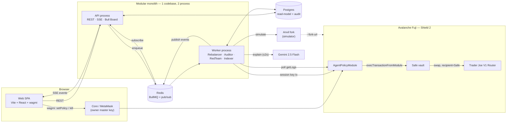
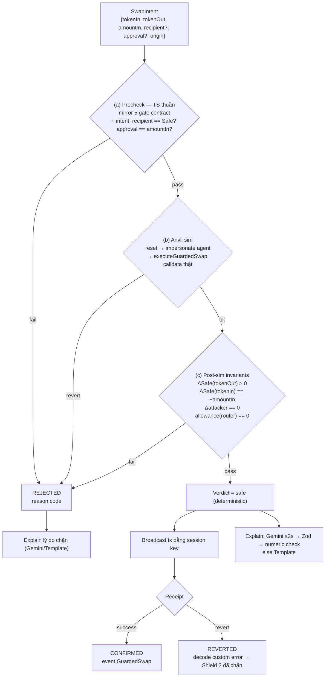
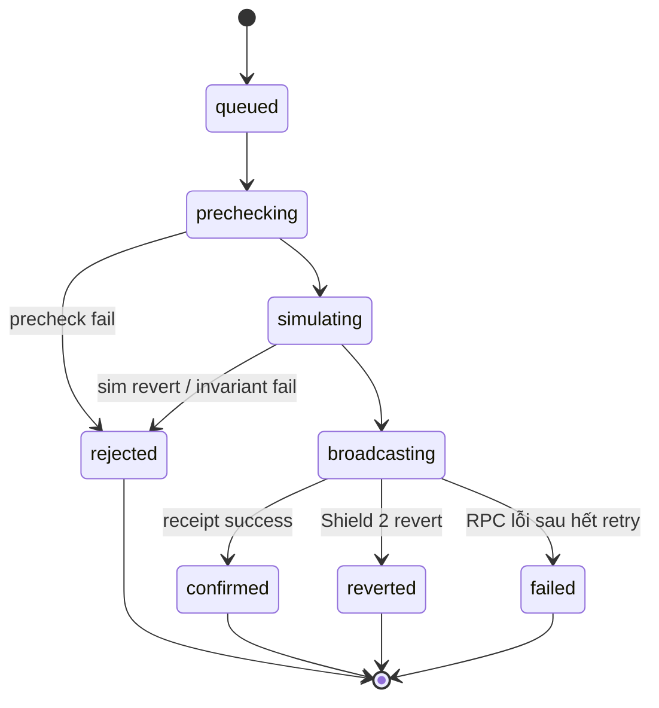
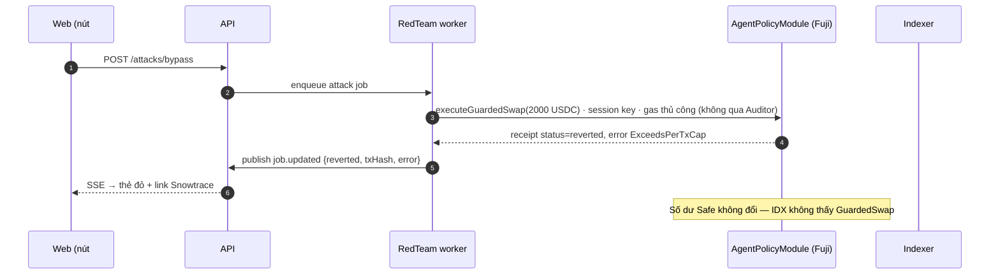
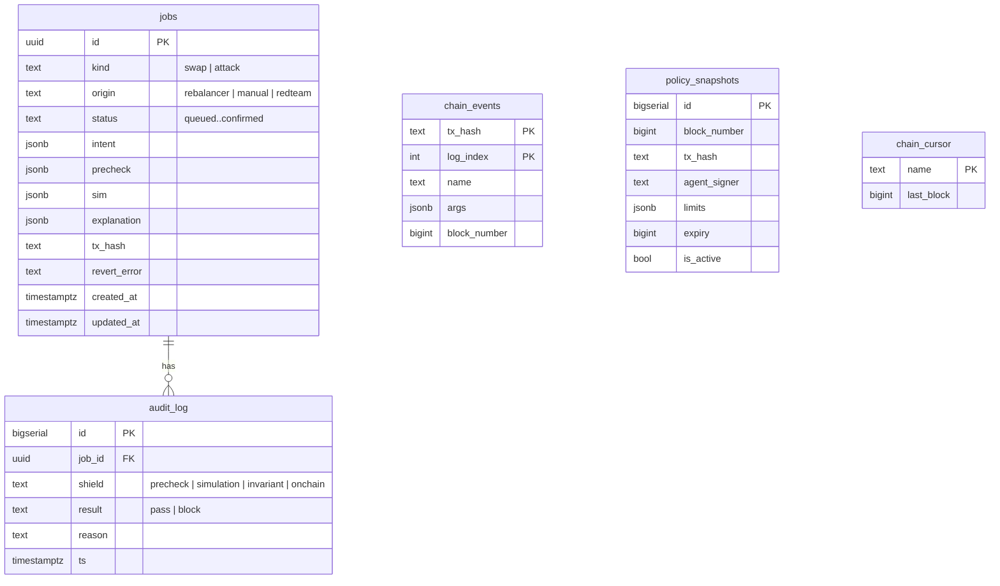
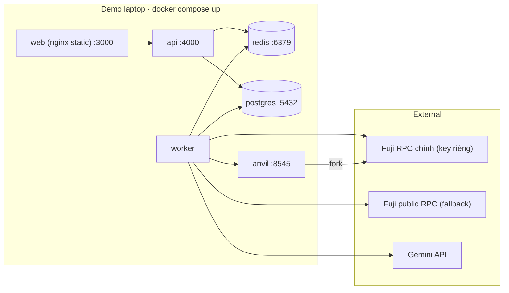

# 🛡️ AgentShield — System Design

> Tài liệu này là **bản thiết kế hệ thống chính thức** (source of truth). Cấu trúc code & folder: [`codebase.md`](./codebase.md). Đặc tả Solidity: [`contracts.md`](./contracts.md). Vận hành & demo: [`../runbook/`](../runbook/). Pitch & FAQ giám khảo: [`../product/pitch.md`](../product/pitch.md).
>
> **Ràng buộc định hình mọi quyết định:** 3 người · 3 tuần · demo 3 phút trên sân khấu · throughput chỉ vài job/phút · *demo không được phép fail* · Technical + Avalanche = 50% điểm.
> → Chọn công nghệ **đủ mạnh để chứng minh kỹ thuật, nhưng ít thành phần nhất có thể**. Mỗi thành phần thêm vào là một điểm có thể sập trên sân khấu.

---

## Mục lục
1. [5 nguyên tắc kiến trúc](#1-5-nguyên-tắc-kiến-trúc)
2. [Kiến trúc tổng thể](#2-kiến-trúc-tổng-thể)
3. [Bảng quyết định công nghệ & tradeoff](#3-bảng-quyết-định-công-nghệ--tradeoff)
4. [Shield 1 — pipeline 3 tầng của AI Auditor](#4-shield-1--pipeline-3-tầng-của-ai-auditor)
5. [Red-team — làm cho mỗi đòn tấn công “thật”](#5-red-team--làm-cho-mỗi-đòn-tấn-công-thật)
6. [Sửa thiết kế smart contract](#6-sửa-thiết-kế-smart-contract)
7. [Data model](#7-data-model)
8. [API & event contract](#8-api--event-contract)
9. [Deployment & độ tin cậy khi demo](#9-deployment--độ-tin-cậy-khi-demo)
10. [Threat → cơ chế chặn (checklist)](#10-threat--cơ-chế-chặn-checklist)
11. [Thuật ngữ](#11-thuật-ngữ)

---

## 1. 5 nguyên tắc kiến trúc

| # | Nguyên tắc | Hệ quả cụ thể |
|---|---|---|
| P1 | **Chain là source of truth.** | Policy, `spentInDay`, trạng thái kill **luôn đọc từ contract**. Postgres chỉ là *read-model* + *audit log off-chain* (kết quả sim, lời giải thích, lý do chặn). Không bao giờ có 2 nguồn sự thật lệch nhau. |
| P2 | **Kill-Switch & setPolicy không đi qua backend.** | Frontend gọi contract trực tiếp bằng ví owner (wagmi). Backend sập hoặc bị chiếm (threat T5) → owner **vẫn kill được**. Bỏ endpoint `POST /kill`. Đây là câu pitch mạnh: *“tắt server của chúng tôi đi, nút Kill vẫn chạy.”* |
| P3 | **LLM không có quyền quyết định.** | `verdict` và `budgetUsedPct` được **tính deterministic**; LLM chỉ viết `messageVi`. Bước giải thích chạy **song song** với broadcast tx → không nằm trên critical path. |
| P4 | **Single-writer cho session key.** | 1 signer = 1 chuỗi nonce → queue `swap` chạy `concurrency = 1`. Không bao giờ có 2 tx cùng nonce / nonce gap. |
| P5 | **Mọi số tiền là `bigint` (đơn vị nhỏ nhất).** | Không float ở bất kỳ đâu. DB lưu `NUMERIC(78,0)`, JSON truyền string. USDC 6 decimals, WAVAX 18 decimals — format chỉ ở tầng UI. |

---

## 2. Kiến trúc tổng thể



**Thay đổi so với bản cũ:**
- Tách **2 process** (`api`, `worker`) từ cùng 1 codebase: worker nặng (sim, LLM, chain) không làm treo API/SSE.
- Thêm **Indexer** (trong worker) đọc event on-chain → đẩy realtime lên UI và ghi projection.
- **Owner ký trực tiếp** từ browser, không qua backend.
- Tổng hạ tầng: **Redis + Postgres + Anvil**. Không thêm broker/indexer/SaaS nào khác.

---

## 3. Bảng quyết định công nghệ & tradeoff

### 3.1 Job queue — **BullMQ** (thắng Kafka, RabbitMQ, pg-boss)

Nhu cầu thực tế của hệ thống:
1. Serialize job swap (P4) · 2. Retry có backoff cho lỗi RPC · 3. **Repeatable job** cho Worker 1 (15s) · 4. Rate-limit gọi Gemini (free tier) · 5. Dedupe job · 6. UI xem queue để khoe giám khảo.

| Tiêu chí | **BullMQ** | Kafka | RabbitMQ | pg-boss |
|---|---|---|---|---|
| Mô hình | Job queue trên Redis | Distributed commit log | AMQP message broker | Job queue trên Postgres |
| Thiết kế cho | Background jobs của 1 app Node | 100k+ msg/s, event streaming, replay nhiều consumer | Routing phức tạp, đa ngôn ngữ | Job queue không muốn thêm Redis |
| Repeat/cron job | ✅ `upsertJobScheduler` | ❌ tự viết | ⚠️ cần plugin delayed-message | ✅ |
| Concurrency=1, retry, backoff | ✅ built-in | ⚠️ qua partition + tự xử lý | ✅ prefetch=1, tự viết retry | ✅ |
| Rate limiter | ✅ built-in | ❌ | ❌ | ⚠️ |
| Dedupe theo jobId | ✅ | ❌ | ❌ | ✅ singletonKey |
| Dashboard | ✅ Bull Board | Kafka UI (nặng) | Management UI | ❌ |
| Chi phí vận hành | 1 container Redis | Broker + KRaft, tuning partition | 1 container + exchange/queue config | 0 (dùng PG sẵn) |
| Phù hợp AgentShield | **Rất cao** | Sai bài toán, overkill | Được nhưng thừa | Được, nhưng vẫn cần Redis cho pub/sub → không lợi |

**Kết luận:** Kafka giải bài toán *throughput và replay log* — hệ thống có vài job/phút, nên dùng Kafka là tín hiệu *over-engineering* với giám khảo kỹ thuật. RabbitMQ mạnh ở routing — ta không có routing. **BullMQ đáp ứng đủ 6 nhu cầu với 1 container Redis**, và Redis còn dùng lại cho pub/sub (3.3).

**Khi nào mới chuyển?** Nhiều Safe × nhiều agent × cần replay audit stream cho nhiều consumer → Kafka/Redpanda. Ghi vào slide “Roadmap scale”.

### 3.2 Realtime tới UI — **SSE** (thắng WebSocket, Socket.IO, polling)

| | **SSE** | WebSocket / Socket.IO | Polling |
|---|---|---|---|
| Hướng dữ liệu | server → client (đúng nhu cầu) | 2 chiều | client kéo |
| Hạ tầng | HTTP thường, qua proxy dễ | Upgrade, sticky session | HTTP |
| Reconnect | Tự động + `Last-Event-ID` | Socket.IO có, WS tự viết | n/a |
| NestJS | `@Sse()` có sẵn | Gateway, adapter | Có |
| Độ trễ | ~ms | ~ms | = chu kỳ poll |

Client không cần push liên tục (thao tác người dùng đi qua REST/wagmi) → WebSocket thừa. **SSE**.

### 3.3 Fan-out event worker → API — **Redis pub/sub**
Worker sinh event (job đổi trạng thái, event chain), API giữ kết nối SSE → cần kênh liên process.
- **Redis pub/sub** (1 channel `agentshield:events`, payload validate bằng Zod `ServerEvent`) ✅ — Redis đã có.
- BullMQ `QueueEvents`: chỉ biết lifecycle job, không biết event chain → thiếu.
- Postgres `LISTEN/NOTIFY`: được, nhưng payload giới hạn 8KB và cần connection riêng → không lợi hơn.
- Pub/sub là fire-and-forget: nếu API restart mất event → UI khi reconnect gọi lại `GET /state` + `GET /jobs` (snapshot) rồi mới nghe stream. **Mô hình “snapshot + stream”**, không cần đảm bảo delivery.

### 3.4 Đọc event on-chain — **tự poll `getLogs` + checkpoint**
| Lựa chọn | Đánh giá |
|---|---|
| WebSocket RPC `eth_subscribe` | Public Fuji WS hay rớt, mất event khi reconnect → không tin cậy cho demo. |
| The Graph / subgraph | Thêm hạ tầng, deploy subgraph, độ trễ index → overkill cho 3 event. |
| Ponder | Indexer TS rất tốt, nhưng thêm 1 service + DB schema riêng. |
| **Poll `getLogs` mỗi 1s, lưu `chain_cursor`** ✅ | ~60 dòng code, resume được sau restart, idempotent nhờ PK `(tx_hash, log_index)`. |

**Insight Avalanche:** Snowman consensus có **finality tức thì** (~1–2s) → **không cần đợi N confirmation, không cần xử lý reorg** như Ethereum. Ghi điều này khi pitch phần Avalanche integration.

### 3.5 Simulation — **Anvil fork, reset mỗi job**
| | `eth_call` / viem `simulateContract` trên Fuji | Tenderly Simulation API | **Anvil fork** |
|---|---|---|---|
| Biết revert + lý do | ✅ | ✅ | ✅ |
| Balance trước/sau, allowance sau swap | ❌ (1 call, không state sau) | ✅ | ✅ (thực thi tx rồi đọc state) |
| Impersonate agent / attacker | ⚠️ chỉ `from` | ✅ | ✅ `anvil_impersonateAccount` |
| Phụ thuộc bên ngoài | RPC | SaaS + quota + mạng | Chỉ RPC để fork |
| Chi phí | 0 | free tier giới hạn | 0 |

**Bẫy quan trọng — fork bị stale:** Anvil fork tại block lúc khởi động. Sau vài swap thật trên Fuji, `spentInDay` trong fork **lệch** với chain thật → sim sai. Giải pháp: **đầu mỗi job gọi `anvil_reset` về block mới nhất** (viem test action `reset`). Queue concurrency 1 nên không có race. Nếu reset chậm (>500ms do tải lazy state), phương án B: `evm_snapshot` trước sim / `evm_revert` sau, và reset định kỳ khi Indexer thấy event `GuardedSwap` mới.

> **Đã chọn phương án B (A5, đo 10/11 trên RPC public Fuji):** `anvil_reset` ~1,5s, mỗi slot nguội sau reset ~0,2s; trên fork đã ấm, snapshot + đọc + revert ~85ms. Vì vậy `AnvilSimulator` chạy mỗi sim trên snapshot gốc rồi `evm_revert`; reset + chạy lại sim gần nhất để làm ấm cache diễn ra **nền** (mỗi 20s, ngay khi `invalidate()` sau tx của mình, và đồng bộ chỉ khi base cũ hơn 60s). Fork lệch vài giây chấp nhận được: precheck đọc chain thật, Shield 2 là bảo đảm cuối.

### 3.6 Web3 library — **viem (BE) + wagmi v2 (FE)**
- Type inference từ ABI `as const` → sai tên hàm/kiểu tham số là lỗi compile.
- `fallback()` transport nhiều RPC (chống RPC chết lúc demo), `nonceManager` cho session key, test actions cho Anvil (`reset`, `impersonateAccount`, `setBalance`).
- **ABI sinh tự động** bằng `@wagmi/cli` plugin Foundry → `packages/shared` → FE và BE dùng chung, contract đổi là TS báo lỗi ngay.
- ethers v6 vẫn tốt nhưng type yếu hơn và không đi cặp tự nhiên với wagmi.

### 3.7 LLM & output guard
| Quyết định | Lý do |
|---|---|
| **Gemini 2.5 Flash, `thinkingBudget = 0`** | Timeout 2s: bật thinking sẽ thường xuyên vượt ngưỡng. Flash-Lite là model dự phòng nhanh hơn. |
| **Structured output** (`responseMimeType: application/json` + `responseSchema`) **+ Zod** | Schema ở 2 lớp: ép model trả JSON, rồi Zod validate lại (không tin model). |
| **Numeric-consistency check** | Trích các số trong `messageVi`, so với sim (`200`, `8`, `13.3`). Lệch → fallback. Chặn hallucination & injection “nói sai số”. |
| **Port `Explainer` + 2 adapter** | `GeminiExplainer` → khi timeout/invalid → `TemplateExplainer`. Fallback là đổi adapter, không phải `if` rải rác. |
| **Prompt injection** | Text người dùng nhét vào prompt trong block delimit `<untrusted_input>`, system prompt nói rõ đó là dữ liệu. Nhưng an toàn thật đến từ P3: dù LLM bị lừa hoàn toàn, nó không có quyền gì. |
| **Cache + limiter** | Cache explanation theo `(scenario, amountIn, verdict)`; BullMQ limiter cho queue explain để không chạm RPM free tier lúc bấm liên tục. |

```ts
// Chỉ phần này do LLM viết. Mọi thứ khác do code tính.
const LlmExplanation = z.object({ messageVi: z.string().min(10).max(280) });

const Explanation = z.object({
  verdict:       z.enum(["safe", "blocked"]),     // deterministic
  budgetUsedPct: z.number().min(0).max(100),      // deterministic
  messageVi:     z.string().max(280),             // LLM hoặc template
  source:        z.enum(["llm", "template"]),     // hiển thị badge trên UI
});
```

### 3.8 Các lựa chọn còn lại

| Feature | Ứng viên | **Chọn** | Vì sao |
|---|---|---|---|
| Database | Postgres, SQLite, MongoDB | **Postgres 16** | Audit trail quan hệ + JSONB cho sim/explanation. Mongo không có lợi gì; SQLite không share được giữa 2 process container dễ dàng. |
| ORM | Prisma, TypeORM, Drizzle | **Drizzle + drizzle-zod** | SQL-first, không binary engine, migration bằng drizzle-kit, schema → Zod. TypeORM decorator-heavy, nhiều bug lâu năm. Prisma ổn nhưng `Decimal`/bigint và codegen phiền hơn. |
| Smart wallet | Safe, ERC-4337 account + session key, vault tự viết | **Safe v1.4.1 + custom Module** | Safe đã audit, có trên Fuji, Protocol Kit deploy dễ. 4337 session keys chuẩn hơn về lâu dài nhưng quá rộng cho 3 tuần. Vault tự viết = mất uy tín bảo mật. |
| DEX | Trader Joe V1 (UniV2-style), Liquidity Book V2 | **TJ V1 Router + pool tự tạo** | `swapExactTokensForTokens(amountIn, minOut, path, to, deadline)` đơn giản. **Rủi ro lớn:** thanh khoản USDC/WAVAX trên Fuji mỏng hoặc không có → deploy `MockUSDC`, tự `addLiquidity` cặp MockUSDC/WAVAX trên factory TJ Fuji → giá demo ổn định, kịch bản lặp lại được. |
| Oracle (stretch) | Chainlink, TWAP | **Chainlink AVAX/USD trên Fuji** | Module tự tính `minOut ≥ price × amountIn × (1 − maxSlippageBps)` → không còn phụ thuộc `minOut` agent gửi lên. Biến “điểm yếu” FAQ #12 thành tính năng nếu kịp tuần 3. |
| Ví owner | MetaMask, Core | **Core + MetaMask qua RainbowKit / ConnectKit** | Core là ví native Avalanche → cộng điểm tích hợp hệ sinh thái. |
| Logging | console, pino, OpenTelemetry | **pino (`nestjs-pino`) + `jobId` correlation + Bull Board** | Đủ debug khi demo; OTel overkill. |
| Config | dotenv thô | **Zod env schema, validate lúc boot** | Thiếu `AGENT_PRIVATE_KEY` → crash ngay khi start, không phải giữa demo. |

---

## 4. Shield 1 — pipeline 3 tầng của AI Auditor

Bản cũ: “Anvil sim → Gemini → sign”. Bản mới tách Shield 1 thành **3 tầng phòng thủ deterministic** + giải thích song song.



**Vì sao cần tầng (a)?** Attack #2 (recipient = hacker) và #3 (approve vô hạn) **không biểu diễn được** qua ABI của module — module không có tham số `recipient` hay `approve`. Nên chúng phải bị bắt ở tầng *intent*. Khi pitch nói trung thực: *“off-chain chúng tôi phát hiện ý đồ; on-chain kẻ tấn công thậm chí không có ô để điền địa chỉ.”*

**Vì sao cần tầng (c)?** Sim không revert chưa chắc là an toàn. Invariant kiểm tra *kết quả kinh tế*: tiền chỉ được đổi, không được rời Safe.

### 4.1 Job state machine (lưu ở `jobs.status`, mỗi transition publish `job.updated`)


`explanation` được gắn vào job khi xong (bất đồng bộ) qua event `job.explained`.

### 4.2 Các quy tắc vận hành
- **Retry chỉ cho lỗi hạ tầng** (RPC timeout, 5xx) — exponential backoff 3 lần. **Không bao giờ retry revert**: revert là kết quả đúng của Shield 2.
- **Idempotency Rebalancer:** `jobId = rebalance:{safe}:{floor(blockNumber/10)}` + bỏ qua nếu queue `swap` còn job `active`/`waiting` → không rebalance 2 lần khi tx trước chưa mined.
- **Clamp số tiền:** Rebalancer luôn `amountIn = min(deviation, maxPerTx, dailyCap − spentToday)`; dưới ngưỡng (vd 2% tổng quỹ) thì skip.
- **Định giá cho Rebalancer:** dùng `router.getAmountsOut` (cùng nguồn giá với pool sẽ swap) → tránh lệch giữa “tính” và “khớp”.

---

## 5. Red-team — làm cho mỗi đòn tấn công “thật”

Giám khảo kỹ thuật sẽ hỏi “đòn này có thật không hay chỉ là UI?”. Mỗi nút phải gây ra **một hành động thật**:

| # | Nút | Thực thi thật sự | Bị chặn bởi | Bằng chứng trên UI |
|---|---|---|---|---|
| 1 | Over-withdraw 2,000 | Intent 2,000 USDC qua API → Auditor | (a) precheck `ExceedsPerTxCap` + (b) sim revert | Thẻ đỏ, reason code, giải thích VN |
| 2 | Wrong recipient | Intent có `recipient = 0x999…`; biến thể 2: agent EOA gọi thẳng router (EOA không có token) | (a) precheck; on-chain: không có tham số | Thẻ đỏ + “recipient bị khóa cứng = Safe” |
| 3 | Unlimited approval | Session key gọi thẳng `safe.execTransactionFromModule(USDC.approve(router, MAX))` | Safe revert **`GS104`** (agent không phải module được enable) | Tx revert trên Snowtrace |
| 4 | Bypass website ⚡ | RedTeam worker ký bằng session key, gửi thẳng Fuji `executeGuardedSwap(2000e6)` với **`gas` set thủ công** | **Shield 2**: `ExceedsPerTxCap` | **Link Snowtrace của tx revert** |
| + | Prompt injection | Text đi vào prompt dưới dạng dữ liệu delimit | P3: LLM không có quyền; numeric check | Badge “LLM bị bỏ qua — template” nếu output sai |

> ⚠️ **Chi tiết kỹ thuật quyết định màn demo #4:** nếu để viem/ví tự `estimateGas`, tx revert sẽ bị chặn **ngay tại client** và **không bao giờ lên chain** → không có bằng chứng Snowtrace. Phải truyền `gas: 300_000n` để tx được mined và revert *on-chain*. Lưu ý agent EOA cần ít AVAX để trả gas.



---

## 6. Sửa thiết kế smart contract

Các lỗ hổng / điểm yếu trong pseudo-code hiện tại và cách sửa:

| # | Vấn đề | Mức độ | Sửa |
|---|---|---|---|
| C1 | Cap đo theo đơn vị `tokenIn` → cap 500 áp cho WAVAX nghĩa là **500 WAVAX** (~hàng chục nghìn USD) | 🔴 Cao | `mapping(address token => Limits{maxPerTx, dailyCap})` + `spentInDay[token][dayId]`. Bản v2: quy USD qua oracle. |
| C2 | `path` có thể bị truyền từ ngoài | 🔴 Cao | Build `path = [tokenIn, tokenOut]` **bên trong** module; check `tokenIn != tokenOut`. |
| C3 | `minOut = 0` cho phép bị sandwich / thao túng giá pool mỏng | 🟠 Trung | Ngắn hạn: `minOut > 0` bắt buộc + slippage check off-chain. Stretch: Chainlink floor on-chain. Thiệt hại tối đa vẫn bị chặn bởi daily cap. |
| C4 | `deadline` tùy ý | 🟡 Thấp | `deadline <= block.timestamp + 10 minutes`. |
| C5 | Allowance thừa sau swap | 🟡 Thấp | Sau swap assert `allowance(safe, router) == 0`, nếu không thì approve(0). |
| C6 | Module call kiểu `DelegateCall` sẽ cho code ngoài chạy trong context Safe | 🔴 Cao | Luôn `Enum.Operation.Call`, hard-code. |
| C7 | Ai là owner? | Thiết kế | `owner` = EOA chủ ví → Kill-Switch = **1 tx ~1.5s**, không cần luồng ký multisig Safe. Lớp kill thứ 2: owner `safe.disableModule()`. |
| C8 | UI cần event để realtime | Thiết kế | `PolicySet`, `PolicyRevoked`, `GuardedSwap(tokenIn, tokenOut, amountIn, amountOut, dayId, spentToday)`. Custom errors để BE/FE decode ra tiếng Việt. |
| C9 | Kiểm tra kết quả swap | 🟡 | Đo `balanceOf(safe, tokenOut)` trước/sau, require `delta >= minOut` (không tin giá trị trả về của router). |

**Testing (Foundry):**
- Unit: 1 test / gate / custom error.
- Fuzz: `testFuzz_attackerNeverProfits(amount, caller)` 10,000 runs.
- **Invariant testing có Handler** (mạnh hơn fuzz đơn, nên khoe): handler gọi ngẫu nhiên `executeGuardedSwap`, `warp` qua ngày, `revoke`, gọi từ attacker…
  - `invariant_spentTodayLeCap()` — `spentInDay[token][today] <= dailyCap` luôn đúng.
  - `invariant_attackerBalanceZero()` — attacker không bao giờ có token.
  - `invariant_revokedMeansNoSpend()` — sau revoke, `spentInDay` không tăng.
- Fork test trên Fuji: swap thật với router TJ + pool đã tạo.

---

## 7. Data model



- Số tiền trong `jsonb` là **string** (bigint serialize), cột số dùng `NUMERIC(78,0)`.
- `chain_events` PK `(tx_hash, log_index)` → Indexer chạy lại bao nhiêu lần cũng không trùng.
- **`spentToday` không lưu DB** — luôn đọc `spentInDay(token, today)` từ contract (P1).

---

## 8. API & event contract

> **Lưu ý:** bảng REST dưới đây là bản đơn-vault ban đầu. Bản multi-vault + auth (route `/vaults/:safe/...`) nằm ở [`api.md`](./api.md).

### 8.1 REST
| Method | Route | Mô tả |
|---|---|---|
| `GET` | `/state` | Balances Safe, policy, `spentToday`, `isActive` — đọc chain, cache 1s |
| `GET` | `/jobs?limit=20` | Lịch sử job + explanation (snapshot cho UI) |
| `GET` | `/jobs/:id` | Chi tiết 1 job + audit_log |
| `POST` | `/rebalance` | `{ amountIn }` — enqueue swap thủ công (nút demo 200 USDC) |
| `POST` | `/attacks/:scenario` | `over-withdraw · wrong-recipient · unlimited-approval · bypass` |
| `POST` | `/attacks/inject` | `{ text }` — prompt injection |
| `POST` | `/admin/rebalancer/pause` · `/resume` | Demo mode |
| `GET` | `/events` | SSE stream |
| `GET` | `/admin/queues` | Bull Board |

~~`POST /kill`~~ — **bỏ**, owner ký trực tiếp từ FE (P2). ~~`POST /policy`~~ — bỏ, policy đọc từ event `PolicySet`.

### 8.2 Queues (BullMQ)
| Queue | Payload | Producer → Consumer | Cấu hình |
|---|---|---|---|
| `swap` | `SwapIntent` | Rebalancer / API → Auditor | `concurrency: 1`, attempts 3 (chỉ lỗi infra) |
| `attack` | `{ scenario, payload }` | API → RedTeam | `concurrency: 1` (cùng session key với swap → dùng chung `NonceManager`) |
| `explain` | `{ jobId, sim, verdict }` | Auditor → Explainer | `concurrency: 2`, limiter theo RPM Gemini |
| *(scheduler)* `rebalance-tick` | — | JobScheduler mỗi 15s → Rebalancer | pause được |

> `swap` và `attack` đều dùng session key → cả hai đi qua **một `TxSender` duy nhất** có mutex + `nonceManager` của viem để giữ P4.

### 8.3 Server events (SSE, Zod discriminated union ở `packages/shared`)
```ts
export const ServerEvent = z.discriminatedUnion("type", [
  z.object({ type: z.literal("job.updated"),   job: JobDto }),
  z.object({ type: z.literal("job.explained"), jobId: z.string(), explanation: Explanation }),
  z.object({ type: z.literal("chain.swap"),    tokenIn: Addr, tokenOut: Addr, amountIn: z.string(), amountOut: z.string(), spentToday: z.string(), txHash: Hash }),
  z.object({ type: z.literal("chain.policy"),  policy: PolicyDto, txHash: Hash }),
  z.object({ type: z.literal("chain.revoked"), txHash: Hash, latencyMs: z.number().optional() }),
]);
```
FE: khi nhận event → `queryClient.setQueryData` (không refetch). Khi reconnect → refetch snapshot `/state`, `/jobs`.

---

## 9. Deployment & độ tin cậy khi demo



| Rủi ro sân khấu | Biện pháp |
|---|---|
| RPC Fuji chết/chậm | viem `fallback([rpcChinh, rpcPublic], { rank: true })` |
| Wi-Fi yếu → Gemini chậm | Timeout 2s → Template (badge `template` trên UI) |
| Rebalancer tự swap giữa lúc đang nói | **Demo mode**: pause scheduler, chỉ bấm tay |
| Thiếu quỹ / policy sai trước giờ thi | `pnpm seed`: mint MockUSDC, addLiquidity, fund Safe, setPolicy, fund gas cho agent |
| Quên env | Zod env schema → crash lúc boot |
| Laptop hỏng | Backup cloud: Vercel (web) + Railway/Fly (api, worker, anvil) + Neon/Upstash |
| Day rollover lúc demo (UTC 00:00 = 7h sáng VN) | Biết trước; `dayId` theo UTC — ghi chú trên slide nếu bị hỏi |

**Thứ tự bring-up:** faucet AVAX → deploy MockUSDC + tạo pool TJ → deploy Safe (Protocol Kit) → deploy module (`forge script`) → owner `enableModule` + `setPolicy` → `docker compose up` → `pnpm seed --verify` → mở `localhost:3000`.

---

## 10. Threat → cơ chế chặn (checklist)

| Threat | Shield 1 (off-chain) | Shield 2 (on-chain) | Ghi chú |
|---|---|---|---|
| T1 LLM hallucination | LLM không quyết định số tiền (Rebalancer là toán thuần) + numeric check | Caps | P3 |
| T2 Prompt injection | Input delimit, LLM không có quyền | Recipient hard-code, caps | P3 |
| T3 Session key bị lộ | — (bị bypass) | 5 gate + per-token caps + Kill-Switch 1.5s | Demo nút #4 |
| T4 Unlimited approval | Precheck intent | Module chỉ approve `amountIn`; agent không phải module (`GS104`) | Demo nút #3 |
| T5 Backend bị chiếm/sập | — | Toàn bộ luật nằm trên chain; **Kill-Switch không qua backend** | P2 |
| T6 *(mới)* Thao túng giá pool | Slippage check từ `getAmountsOut` | `minOut > 0`, delta balance check; stretch: Chainlink floor | Thiệt hại bị chặn trên bởi daily cap |
| T7 *(mới)* Lộ owner key | — | Ngoài phạm vi; roadmap: Safe 2/3 multisig owner | Nói trung thực |

**Giới hạn đã biết (nói trung thực khi bị hỏi):** cap tính theo đơn vị `tokenIn` từng token (chưa quy USD); `minOut` do agent gửi (stretch: floor từ Chainlink); 1 agent / 1 router / 1 Safe; chỉ testnet Fuji; thanh khoản Fuji mỏng nên dùng `MockUSDC` + pool tự tạo.

---

## 11. Thuật ngữ

| Thuật ngữ | Nghĩa | Vai trò |
|---|---|---|
| **Safe** | Ví thông minh (Gnosis Safe) giữ toàn bộ tiền | Agent không bao giờ giữ key của Safe |
| **Owner key** | Key chủ ví (EOA, Core/MetaMask) | Chỉ ký trong browser: `setPolicy`, Kill-Switch |
| **Session key** | Key giới hạn cấp cho agent (`agentSigner`) | Chỉ `modules/execution` được dùng; thu hồi bằng Kill-Switch |
| **AgentPolicyModule** | Module Safe chứa luật on-chain (Shield 2) | Chặn mọi call ngoài luật, kể cả khi bypass backend |
| **Shield 1** | Precheck + Anvil sim + invariant (off-chain) | Bắt sớm, có thể bị bypass |
| **Shield 2** | Module on-chain | Không thể bypass |
| **Anvil fork** | Bản sao Fuji chạy local | Mô phỏng tx miễn phí trước khi ký thật |
| **Exact approval** | Approve đúng `amountIn` | DEX không bao giờ có allowance dư |
| **dayId** | `block.timestamp / 1 days` (UTC) | Qua ngày mới counter tự về 0, không cần cron |
