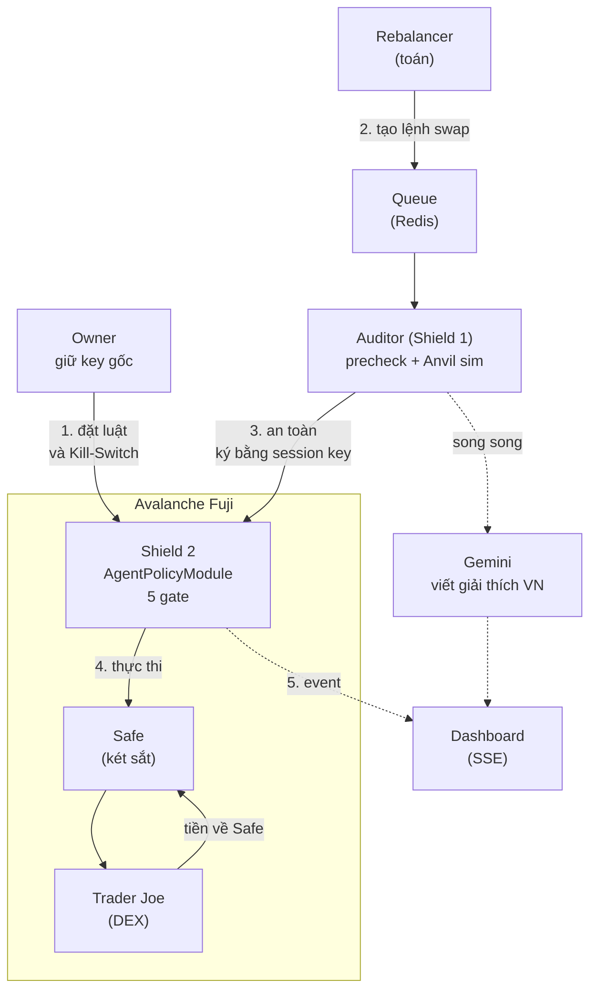
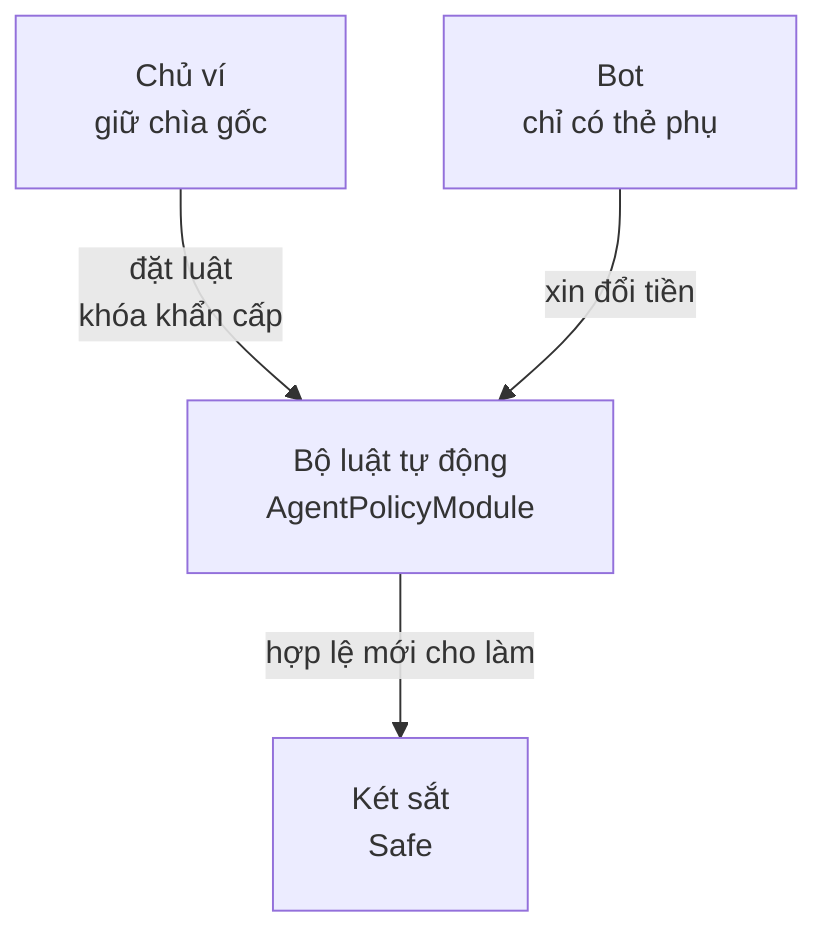
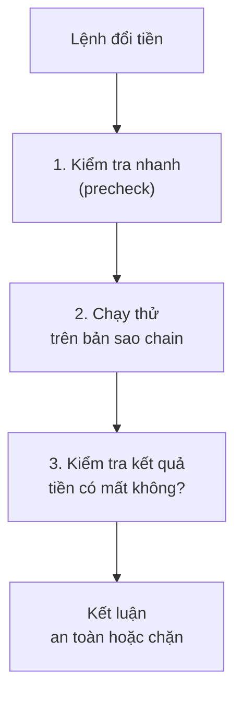
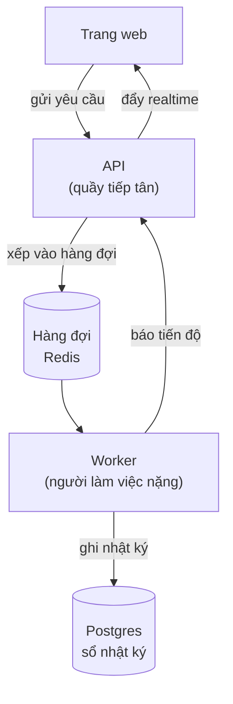

> **Nhập môn khái niệm cho người mới** — không phải spec kỹ thuật. Khi lệch với [`../architecture/`](../architecture/), bản trong `architecture/` thắng. File này chỉ giải thích *"đây là cái gì, vì sao có mặt, nối với cái gì"*; chi tiết nằm ở [`system-design.md`](../architecture/system-design.md), [`contracts.md`](../architecture/contracts.md), [`codebase.md`](../architecture/codebase.md).

# 🎓 AgentShield — Nhập môn khái niệm (đọc 30–40 phút)

## Cách đọc file này

Đừng học thuật ngữ rời rạc. Các khái niệm dưới đây xếp thành **10 cụm**, mỗi cụm trả lời một câu hỏi và **dẫn sang cụm sau**:

```
Cụm 1: Blockchain là gì?            → "tiền nằm ở đâu, ai ký được?"
Cụm 2: Vấn đề giao quyền cho AI     → "đưa key cho AI thì sao?"
Cụm 3: Giải pháp on-chain (Shield 2)→ "luật cứng trên chain"
Cụm 4: DEX & swap                   → "AI thực sự làm gì với tiền?"
Cụm 5: Phòng thủ off-chain (Shield 1)→ "bắt lỗi sớm, trước khi tốn gas"
Cụm 6: AI đúng chỗ                  → "LLM được làm gì và KHÔNG được làm gì"
Cụm 7: Hạ tầng backend              → "queue, worker, realtime"
Cụm 8: Frontend & web3              → "owner ký ở đâu?"
Cụm 9: 5 nguyên tắc P1–P5           → "gói lại thành luật sống còn"
Cụm 10: Ghép lại                    → "trace 1 swap thật + 1 đòn hack"
```

Mỗi khái niệm có cùng khuôn: **Là gì** → **Liên tưởng** → **Trong AgentShield** → **Ví dụ số**. Cuối mỗi cụm có 2–3 câu tự kiểm tra.

Số dùng xuyên suốt (giá trị demo): Safe có **10,000 USD**, policy **`maxPerTx` = 500 USDC**, **`dailyCap` = 1,500 USDC**, bot muốn đổi **200 USDC → ~8 WAVAX**.

---

## 0. Bản đồ tổng thể



**Câu chuyện 1 lệnh swap, trong 1 đoạn:** Chủ ví đặt luật lên chain. Bot toán học thấy quỹ lệch tỷ trọng, tạo lệnh "đổi 200 USDC sang WAVAX" và xếp vào hàng đợi. Auditor chạy thử lệnh trên bản sao của chain, nếu an toàn thì ký bằng *thẻ phụ* (session key) gửi lên chain. Contract luật (Shield 2) kiểm tra lần cuối, nếu đạt thì bảo két sắt đổi tiền và **nhận về chính két**. Kết quả hiện realtime trên dashboard cùng lời giải thích tiếng Việt. Nếu có kẻ xấu chen vào ở bất kỳ bước nào, contract luật vẫn từ chối.

---

## Cụm 1 — Blockchain nền tảng

*Câu hỏi: tiền nằm ở đâu và ai có quyền chuyển nó?*

| Khái niệm | Là gì | Liên tưởng | Trong AgentShield |
|---|---|---|---|
| **Blockchain** | Sổ cái dùng chung, ghi nối tiếp, không sửa/xóa được | Cuốn sổ kế toán công khai mà ai cũng giữ bản sao | Mạng **Avalanche Fuji** là nơi tiền và luật tồn tại |
| **Transaction (tx)** | Một lệnh đã ký, gửi lên mạng để thay đổi sổ cái | Phiếu chuyển tiền có chữ ký | Mỗi lệnh swap = 1 tx |
| **Wallet / EOA** | Tài khoản do **một private key** điều khiển (Externally Owned Account) | Tài khoản ngân hàng mà ai có mật khẩu là toàn quyền | Owner (Core/MetaMask) và agent đều là EOA |
| **Private key** | Chuỗi bí mật dùng để ký tx | Mật khẩu + con dấu gộp làm một, **mất là mất tiền, lộ là mất tiền** | Owner key chỉ ở trình duyệt; session key chỉ `modules/execution` được cầm |
| **Smart contract** | Chương trình chạy trên chain, ai gọi cũng bị áp luật như nhau | Máy bán hàng tự động: bỏ đúng tiền ra đúng hàng, không thương lượng | `AgentPolicyModule` là một smart contract |
| **Gas** | Phí trả để mạng xử lý tx | Tiền xăng | Agent EOA cần ít AVAX để trả gas |
| **Revert** | Contract từ chối, **toàn bộ thay đổi bị hủy** | Máy bán hàng nhả tiền lại | Cách Shield 2 "chặn" tấn công |
| **Testnet (Fuji)** | Mạng thử nghiệm, token không có giá trị | Sân tập có đạn cao su | Mọi thứ chạy trên Fuji, tiền faucet miễn phí |
| **Finality** | Khi tx được coi là xong, không bị đảo lại | Con dấu đã đóng | Avalanche ~1–2s → Kill-Switch có hiệu lực gần như tức thì, **không cần đợi nhiều confirmation** |
| **Token (USDC, WAVAX)** | Tài sản do contract ghi số dư | Số dư trong sổ, không phải tờ tiền thật | Hai đồng trong két |
| **Decimals** | Chain chỉ lưu số nguyên; 1 USDC = `1_000_000` (6 số lẻ), 1 WAVAX = `10^18` | Tính tiền bằng "xu" thay vì "đồng" | Vì thế **mọi số tiền là `bigint`/string, cấm float** (P5) |

**Ví dụ số:** `500 USDC` trên chain là `500_000_000`. Nếu dùng float `0.1 + 0.2 = 0.30000000000000004`, một lỗi làm tròn nhỏ ở tầng tiền là một lỗ hổng.

**→ Tiếp theo:** nếu key = toàn quyền, vậy giao việc cho AI thì sao?

**Tự kiểm tra:** (1) Vì sao revert an toàn hơn "báo lỗi rồi để người dùng tự xử lý"? (2) Vì sao không dùng `number` của JavaScript cho tiền?

---

## Cụm 2 — Vấn đề: giao quyền cho AI

*Câu hỏi: nếu đưa key cho bot thì chuyện gì xảy ra?*

| Khái niệm | Là gì | Liên tưởng | Trong AgentShield |
|---|---|---|---|
| **AI agent** | Chương trình tự ra quyết định và hành động liên tục | Nhân viên làm ca đêm | Bot giao dịch 24/7 |
| **Hallucination** | Mô hình ngôn ngữ bịa số liệu/sự kiện nghe rất hợp lý | Nhân viên tự tin nhưng nhớ sai | Là lý do LLM không được quyết định số tiền |
| **Prompt injection** | Kẻ xấu nhét lệnh vào dữ liệu để "dụ" LLM làm sai | Ai đó đưa nhân viên tờ giấy ghi "chuyển hết tiền cho tôi" | Ô nhập text trên web để demo tấn công |
| **Blast radius** | Thiệt hại tối đa nếu thành phần đó bị chiếm | Bán kính vụ nổ | Mục tiêu thiết kế: bán kính nổ nhỏ dù bot bị chiếm hoàn toàn |

**Bài toán gốc:** chain không có "tổng đài hoàn tiền". Tx đã mined là mất vĩnh viễn. Nên không thể "tin bot rồi sửa sau".

**Vì sao không tạo ví phụ 500$ cho bot?** Bị hack là mất đúng 500$ vào túi hacker. Với AgentShield, bot được *đổi* 500$ nhưng tiền đổi ra **bắt buộc quay về két**, nên hacker không có đường lấy tiền ra.

**→ Tiếp theo:** vậy phải có một "ổ khóa" mà chính bot cũng không mở được. Đó là Cụm 3.

**Tự kiểm tra:** (1) Phân biệt hallucination và prompt injection. (2) "Ví phụ 500$" khác "Safe + policy" ở điểm nào?

---


## Cụm 3 — Giải pháp: "ổ khóa" nằm trên blockchain (Shield 2)

*Câu hỏi: làm sao để bot làm được việc nhưng không lấy được tiền?*

### Ý tưởng trong 1 câu
Tiền nằm trong một **két sắt đặc biệt**. Két có gắn một **bộ luật tự động**. Bot chỉ có một **thẻ phụ**, và mọi lần quẹt thẻ đều phải qua bộ luật đó. Bộ luật nằm trên blockchain nên **không ai sửa được, kể cả đội mình**.



### Các nhân vật (học theo vai, đừng học thuộc tên)

| Tên kỹ thuật | Nói đơn giản là | Ví dụ đời thường |
|---|---|---|
| **Safe** | Một cái **ví là một chương trình** (không phải chỉ một cặp key). Vì là chương trình nên có thể gắn thêm luật vào | Két sắt ngân hàng có khe để lắp thêm ổ khóa điện tử |
| **Owner key** (chìa chủ) | Chìa khóa gốc, **chỉ chủ ví giữ**, chỉ dùng trong trình duyệt của chủ ví | Chìa khóa gốc của két |
| **Session key** (chìa tạm) | Một chìa riêng cho bot, **quyền rất hẹp**: chỉ được xin đổi tiền theo luật | Thẻ phụ ngân hàng: tiêu có hạn mức, mất thì khóa |
| **Module** | "Phụ kiện" gắn vào Safe để Safe nghe lệnh theo một bộ luật riêng | Ổ khóa điện tử lắp thêm vào két |
| **`AgentPolicyModule`** | Tên file code của ổ khóa điện tử của dự án mình (khoảng 180 dòng Solidity) | |
| **Policy** (chính sách) | Danh sách luật: ai được ra lệnh, token nào được đổi, trần bao nhiêu, hết hạn khi nào | Điều khoản trên tấm thẻ phụ |

> **Smart contract là gì?** Là một chương trình nằm trên blockchain. Ai gọi nó cũng bị áp **cùng một luật**, nó không "nể" ai và không ai sửa được sau khi đã đưa lên. Ổ khóa điện tử ở trên chính là một smart contract.

### Bộ luật hoạt động thế nào: 5 câu hỏi "soát vé" liên tiếp
Mỗi lần bot xin đổi tiền, ổ khóa hỏi lần lượt (gọi là **gate**, tức "cổng"). **Sai một câu là bị từ chối ngay.** Từ chối này gọi là **revert**: toàn bộ thao tác bị hủy như chưa từng xảy ra, tiền không mất đi đâu.

| # | Ổ khóa hỏi | Nếu sai thì |
|---|---|---|
| 1 | Người xin có đúng là **bot được cấp thẻ** không? Thẻ còn hiệu lực, chưa bị khóa, chưa hết hạn? | Từ chối |
| 2 | Hai loại tiền định đổi có **nằm trong danh sách cho phép** (USDC, WAVAX) không? | Từ chối |
| 3 | **Một lần** đổi có vượt trần 500 USDC không? | Từ chối |
| 4 | **Cả ngày** đã tiêu + lần này có vượt trần 1,500 USDC không? | Từ chối |
| 5 | Khi đổi: chỉ cho sàn rút **đúng số tiền của lệnh này**, và tiền đổi ra **bắt buộc chảy về chính két** | Từ chối |

Hai chi tiết giúp bạn trả lời giám khảo:
- **"Một ngày" tự reset thế nào?** Contract lấy giờ hiện tại chia cho 86,400 giây để ra "số thứ tự ngày". Sang ngày mới thì số đổi nên bộ đếm bắt đầu lại từ 0, **không cần ai bấm reset**. (Đây là `dayId`.)
- **Điểm mạnh nhất:** hàm bot gọi **không có ô "người nhận"**. Kẻ tấn công không có chỗ để điền ví của họ. Mạnh hơn kiểu "kiểm tra rồi từ chối" là kiểu "không cho khả năng làm".

### Nút Kill-Switch (khóa khẩn cấp)
Chủ ví bấm một nút, ký bằng ví của mình, và thẻ phụ của bot **bị vô hiệu hóa trong khoảng 1.5 giây**. Nút này **không đi qua server của đội mình**, mà chủ ví gọi thẳng tới contract. Nhờ vậy dù server sập hay bị hack, chủ ví vẫn khóa được.

### Tấn công nào bị chặn bởi gì?

| Kẻ xấu làm gì | Bị chặn thế nào |
|---|---|
| Đòi rút 2,000 USDC | Câu hỏi 3: vượt trần 500 mỗi lần |
| Đòi tiền chảy về ví hacker | Không có ô để điền người nhận |
| Đòi cấp quyền rút "vô hạn" | Module chỉ cấp đúng số tiền của lệnh; gọi thẳng Safe thì bị từ chối vì bot không phải module |
| Lấy được thẻ phụ, bỏ qua website, bắn thẳng lên chain | Bộ luật vẫn chạy 5 câu hỏi vì nó nằm **trên chain**, không nằm ở website |
| Server của đội bị hack/sập | Chủ ví vẫn bấm Kill-Switch trực tiếp |

**→ Tiếp theo:** bộ luật mới nói *được hay không*. Còn việc "đổi tiền" thật sự diễn ra thế nào? Cụm 4.

**Tự kiểm tra:** (1) Chìa chủ khác thẻ phụ ở điểm nào? (2) Revert nghĩa là gì và vì sao nó an toàn? (3) Vì sao Kill-Switch không được đi qua server?

---

## Cụm 4 — Đổi tiền (swap) hoạt động thế nào

*Câu hỏi: bot thực sự làm gì với tiền trong két?*

Bot chỉ có **một việc**: đổi qua lại giữa hai loại tiền (USDC ↔ WAVAX) để giữ tỷ lệ mong muốn. Đây gọi là **rebalancing** (cân bằng lại danh mục).

| Từ | Nói đơn giản là | Ví dụ |
|---|---|---|
| **Token** | Một loại "tiền" trên blockchain. **USDC** giữ giá ~1 USD. **WAVAX** là AVAX bọc lại, giá dao động | Như USD và vàng trong ví |
| **DEX** | Sàn đổi tiền **do chương trình chạy**, không có công ty ở giữa. Dự án dùng **Trader Joe** | Quầy đổi ngoại tệ tự động |
| **Swap** | Một lần đổi tiền loại này sang loại kia | Đổi 200 USDC lấy ~8 WAVAX |
| **Approve** (cho phép rút) | Muốn sàn lấy tiền của mình để đổi, phải **cho phép trước** | Ủy quyền cho thu ngân rút tiền |
| **Exact approval** | Chỉ cho phép đúng số tiền của lệnh này (200), xong đưa về 0 | Đưa đúng 200$, không đưa cả ví |
| **`minOut`** | Số tối thiểu mình chấp nhận nhận về. Giá trượt quá thì hủy | "Ít hơn 7.9 WAVAX thì khỏi đổi" |
| **Slippage** (trượt giá) | Giá lúc tính khác giá lúc khớp | Giá nhích lên xuống chút giữa lúc báo giá và lúc khớp lệnh |

**Vì sao cấm "approve vô hạn"?** Nếu cho sàn rút không giới hạn, lỡ sàn lỗi hoặc bị hack thì **rút sạch tiền trong két**. Cho đúng 200 rồi thu hồi về 0 thì không còn gì để rút.

**Ví dụ:** két có 500 USDC và 400 USDC-giá-trị-WAVAX → WAVAX thiếu 50 → bot tạo lệnh "đổi 50 USDC sang WAVAX". Con số 50 do **công thức toán** tính, không phải AI nghĩ ra.

**→ Tiếp theo:** ổ khóa on-chain tốn tiền xăng và chậm mỗi khi từ chối. Có cách bắt lỗi trước không? Cụm 5.

**Tự kiểm tra:** (1) Vì sao chỉ approve đúng số tiền của lệnh? (2) `minOut` bảo vệ khỏi chuyện gì?

---

## Cụm 5 — Lớp kiểm tra thứ hai, đặt ở ngoài chain (Shield 1)

*Câu hỏi: có cách nào phát hiện lệnh xấu sớm, rẻ, và giải thích được cho người dùng không?*

Dự án có **hai lớp khiên**:

| | Shield 1 (ngoài chain) | Shield 2 (trên chain) |
|---|---|---|
| Là gì | Kiểm tra và diễn tập **trước khi** gửi lệnh | Bộ luật ở Cụm 3 |
| Ưu điểm | Nhanh, miễn phí, giải thích được lý do | **Không ai bypass được** |
| Nhược điểm | Hacker có thể bỏ qua nó | Từ chối trễ hơn, tốn phí |
| Ví dụ | Bảo vệ soát ở cổng | Khóa cửa két |

Hai lớp bổ sung nhau: lớp 1 cho trải nghiệm tốt, lớp 2 là chốt chặn cuối.

### Shield 1 làm 3 việc nối tiếp



| Bước | Nói đơn giản là |
|---|---|
| **Precheck** | Đọc lệnh và tự hỏi 5 câu giống ổ khóa. Thêm 2 câu: *"người nhận có phải két không? approve có đúng số tiền không?"* |
| **Anvil fork** | Một **bản sao của blockchain chạy trên máy mình**. Chạy thử lệnh ở đó **không tốn tiền thật** và biết trước kết quả |
| **Invariant** | "Điều luôn phải đúng sau khi chạy thử": két phải nhận được tiền mới, mất đúng số tiền định đổi, ví hacker vẫn bằng 0 |
| **Verdict** (kết luận) | `an toàn` hay `chặn`. **Do code quyết định, không phải AI** |

**Mẹo nhớ:** Anvil giống "phòng tập có bản sao y hệt thế giới thật": thử sai thoải mái, xong không để lại hậu quả. Mỗi lần thử, ta **reset** bản sao về trạng thái mới nhất để không thử trên số liệu cũ.

**→ Tiếp theo:** vậy AI đóng vai trò gì? Cụm 6.

**Tự kiểm tra:** (1) Vì sao cần cả hai lớp khiên? (2) Chạy thử trên Anvil có tốn tiền thật không?

---

## Cụm 6 — AI chỉ làm đúng việc của nó

*Câu hỏi: AI được làm gì và không được làm gì?*

> **Quy tắc vàng:** AI **chỉ viết lời giải thích tiếng Việt**. Số tiền, kết luận, việc ký lệnh đều do **code cố định** quyết định.

| Ai làm | Việc gì | Dùng AI? |
|---|---|---|
| **Bot cân bằng** (Rebalancer) | Tính đổi bao nhiêu, mỗi 15 giây | **Không**, chỉ là phép tính phần trăm |
| **Auditor** (kiểm toán) | Chạy thử, đưa ra kết luận an toàn hay chặn | **Không**, code quyết định |
| **Explainer** (giải thích) | Viết câu "Giao dịch an toàn, tiêu 13.3% hạn mức ngày" | **Có**: Gemini |
| **Red-team** (giả hacker) | Bấm nút để diễn tập 4 đòn tấn công trên màn hình demo | Không |

**Vì sao không để AI quyết định?** AI hay "nói bậy nghe rất hợp lý" (hallucination) và có thể bị lừa bằng câu chữ (prompt injection). Nếu AI không có quyền gì, thì dù bị lừa hoàn toàn nó cũng **không hại được tiền**.

### Các lớp chống AI nói sai
- **Ép khuôn đầu ra:** AI chỉ được trả về một trường duy nhất là câu giải thích, không viết tự do.
- **Đối chiếu số:** các số trong câu AI viết phải khớp kết quả chạy thử. Lệch thì bỏ câu đó.
- **Dự phòng:** quá 2 giây AI chưa trả lời, hoặc câu sai, thì dùng **câu mẫu có sẵn** điền số vào. UI hiện nhãn `template` để minh bạch.

**Ví dụ:** chạy thử trả "trừ 200 USDC, +8 WAVAX, dùng 13.3% hạn mức". AI viết "An toàn, tiêu 13.3% hạn mức ngày" → khớp, hiển thị. Nếu AI viết "tiêu 30%" → lệch, chuyển sang câu mẫu.

**→ Tiếp theo:** tất cả cần chạy ổn định, tuần tự, realtime. Cụm 7.

**Tự kiểm tra:** (1) Ai quyết định số tiền đổi? (2) Khi Gemini chậm quá 2 giây thì sao?

---

## Cụm 7 — Hệ thống phía sau (backend) chạy thế nào

*Câu hỏi: lệnh đi qua những "trạm" nào, và vì sao cần từng trạm?*



| Trạm | Nói đơn giản là | Vì sao cần |
|---|---|---|
| **API** | "Quầy tiếp tân" nhận yêu cầu từ trang web | Phản hồi nhanh, không bị đơ vì việc nặng |
| **Worker** | "Xưởng phía sau": chạy thử, hỏi AI, gửi lệnh lên chain | Tách riêng để việc nặng không làm treo quầy tiếp tân |
| **Hàng đợi (BullMQ + Redis)** | Xếp lệnh thành hàng, làm **từng cái một** | Bấm liên tục 4 nút hack vẫn chạy mượt, không xung đột |
| **Nonce** | Số thứ tự các lệnh của một tài khoản trên chain (1, 2, 3…) | Hai lệnh cùng số thứ tự thì hỏng → ta chỉ xử lý **một lệnh một lúc** |
| **Retry** | Thử lại khi lỗi mạng | Chỉ thử lại lỗi **đường truyền**. **Không thử lại khi bị revert**, vì revert là câu trả lời đúng của ổ khóa |
| **SSE** | Server **đẩy** thông báo xuống trang web, như radio | Màn hình cập nhật tức thì, không cần bấm F5 |
| **Indexer** | Mỗi giây hỏi chain "có sự kiện mới không?" rồi ghi lại | Để UI biết chain vừa có swap |
| **Postgres** | Cơ sở dữ liệu để **ghi nhật ký** (kết quả chạy thử, lý do chặn, lời giải thích) | **Không** lưu số tiền đã tiêu hôm nay, số này luôn đọc từ chain |

**Quy tắc quan trọng:** thông tin về tiền và luật luôn lấy từ **chain**, không sao chép sang database. Có hai nơi cùng giữ một con số thì sớm muộn chúng sẽ lệch nhau.

**Vòng đời của một lệnh:** `xếp hàng → kiểm tra → chạy thử → gửi lên chain → thành công / bị chặn bởi ổ khóa / lỗi mạng`. Mỗi bước đều báo lên màn hình.

**→ Tiếp theo:** phía người dùng thì sao? Cụm 8.

**Tự kiểm tra:** (1) Vì sao chỉ xử lý một lệnh một lúc? (2) Vì sao không retry khi bị revert?

---

## Cụm 8 — Phía người dùng (frontend) và các thư viện web3

*Câu hỏi: chủ ví thao tác ở đâu, và code chia sẻ thông tin giữa các phần thế nào?*

| Từ | Nói đơn giản là |
|---|---|
| **Ví (Core, MetaMask)** | Ứng dụng giữ chìa chủ. Mỗi lần ký, nó hiện hộp thoại để bạn xác nhận |
| **RPC** | "Đường dây điện thoại" để chương trình nói chuyện với blockchain. Dự án dùng 1 đường chính + 1 đường dự phòng |
| **ABI** | "Sách hướng dẫn sử dụng" của một smart contract: có hàm nào, nhận tham số gì. Tự sinh từ code contract |
| **viem** | Bộ đồ nghề (thư viện TypeScript) để backend nói chuyện với chain |
| **wagmi** | Bộ đồ nghề tương tự nhưng dành cho giao diện React: kết nối ví, ký lệnh |
| **Zod** | "Hải quan" kiểm dữ liệu: dữ liệu đi qua phải đúng khuôn mới được dùng |
| **SIWE** | Đăng nhập bằng cách **ký một tin nhắn bằng ví**, thay cho mật khẩu |
| **Snowtrace** | Trang web tra cứu mọi giao dịch trên Avalanche, dùng làm bằng chứng khi demo |

**Vì sao chủ ví ký ngay trong trình duyệt?** Vì nếu việc đặt luật và khóa khẩn cấp đi qua server, kẻ chiếm server sẽ chiếm luôn quyền kiểm soát. Ký trực tiếp nghĩa là *"tắt server của chúng tôi đi, nút Kill vẫn chạy."*

**Vì sao ABI quan trọng?** Contract đổi hàm thì chạy `pnpm --filter shared gen` để sinh lại ABI. Cả web và backend dùng chung nên TypeScript báo lỗi ngay chỗ nào cần sửa, không để lỗi lọt tới lúc demo.

**Tự kiểm tra:** (1) Vì sao nút Kill-Switch gọi thẳng contract? (2) ABI dùng để làm gì?

---

## Cụm 9 — 5 nguyên tắc cần nhớ (P1–P5)

Đây là những quy tắc gói lại mọi thứ ở trên. Vi phạm một quy tắc nghĩa là có thể mất tiền hoặc hỏng demo.

| # | Quy tắc | Giải thích 1 dòng | Ví dụ |
|---|---|---|---|
| P1 | **Chain là nguồn sự thật** | Số tiền đã tiêu, luật hiện tại: luôn đọc từ chain | Không lưu "đã tiêu 200" vào database |
| P2 | **Chủ ví ký ở trình duyệt** | Đặt luật và khóa khẩn cấp không đi qua server | Server sập, vẫn khóa được |
| P3 | **AI chỉ viết lời giải thích** | Kết luận và số tiền do code quyết định | AI bị lừa cũng không hại được tiền |
| P4 | **Một chìa, một lúc một lệnh** | Tránh trùng số thứ tự lệnh (nonce) | Hàng đợi chạy từng lệnh |
| P5 | **Tiền là số nguyên nhỏ nhất** | Không dùng số thập phân | 500 USDC lưu thành `500000000` |

Hai quy tắc phụ khi viết code: chỉ `modules/execution` được đụng chìa của bot, và **chìa chủ không bao giờ** vào backend hay file env.

---

## Cụm 10 — Ghép lại: hai câu chuyện từ đầu đến cuối

### Câu chuyện A: một lệnh đổi tiền hợp lệ (200 USDC → ~8 WAVAX)

1. **Chuẩn bị:** chủ ví đã đặt luật lên chain: mỗi lần tối đa 500, mỗi ngày tối đa 1,500 USDC (Cụm 3).
2. **Bot tính:** két đang lệch tỷ lệ → bot tạo lệnh "đổi 200 USDC sang WAVAX" (Cụm 4, 6).
3. **Xếp hàng:** lệnh vào hàng đợi, chờ đến lượt (Cụm 7).
4. **Kiểm tra nhanh:** 200 ≤ 500, người nhận là két, approve đúng 200 (Cụm 5).
5. **Chạy thử:** trên bản sao chain thấy trừ 200 USDC, +8 WAVAX → kết luận **an toàn** (Cụm 5).
6. **Song song:** AI viết "An toàn, tiêu 13.3% hạn mức ngày" (Cụm 6).
7. **Gửi lên chain:** bot ký bằng thẻ phụ, gửi lệnh (Cụm 3).
8. **Ổ khóa kiểm tra lần cuối:** qua đủ 5 cổng → két approve đúng 200 → đổi → 8 WAVAX về két → thu hồi quyền (Cụm 3, 4).
9. **Hiển thị:** thanh hạn mức nhảy lên 200 / 1,500 và lời giải thích xuất hiện trên màn hình (Cụm 7).

### Câu chuyện B: hacker bỏ qua website, bắn thẳng lên chain (nút đỏ số 4)

1. **Giả sử hacker có thẻ phụ** và gửi thẳng lệnh "rút 2,000 USDC", **không qua Auditor**.
2. **Ổ khóa trên chain** kiểm tra: 2,000 > 500 → **revert**.
3. **Lệnh vẫn nằm trên chain** (là một giao dịch thất bại), nên có link Snowtrace làm bằng chứng. Để làm được, lúc demo phải đặt sẵn mức phí xăng thủ công, nếu không chương trình tự ước lượng sẽ chặn lệnh trước khi nó lên chain.
4. **Két giữ nguyên 100% tiền.** Màn hình hiện thẻ đỏ kèm lý do bằng tiếng Việt.

### Đọc tiếp theo vai trò

| Vai | Đọc tiếp |
|---|---|
| FS1 (smart contract) | [`contracts.md`](../architecture/contracts.md), skill `policy-module-contract`, `secure-workflow-guide` |
| FS2 (web + queue + Anvil) | [`codebase.md`](../architecture/codebase.md), [`api.md`](../architecture/api.md), [`ui-pages.md`](../product/ui-pages.md), [`design-system.md`](../product/design-system.md) |
| AIE (AI + red-team) | `system-design.md` §3.7, §4, §5; skill `llm-explainer-guard`, `redteam-scenarios` |
| Mọi người | [`system-design.md`](../architecture/system-design.md) trước khi viết code, [`pitch.md`](../product/pitch.md) để chuẩn bị trả lời giám khảo |

---

## Phụ lục — Từ điển nhanh (A–Z)

Gặp từ lạ thì tra ở đây. Cột "Cụm" cho biết chỗ giải thích kỹ.

| Thuật ngữ | Cụm | Nói đơn giản là |
|---|---|---|
| ABI | 8 | Sách hướng dẫn sử dụng của smart contract |
| Allowance / Approve | 4 | Cho phép sàn rút tiền của mình, tối đa N |
| Anvil fork | 5 | Bản sao blockchain chạy trên máy mình để thử miễn phí |
| BullMQ / Hàng đợi | 7 | Xếp lệnh thành hàng, làm từng cái |
| `dayId` | 3 | Số thứ tự ngày, giúp hạn mức ngày tự reset |
| DEX | 4 | Sàn đổi tiền do chương trình chạy |
| EOA | 1 | Tài khoản thường, do một private key điều khiển |
| Exact approval | 4 | Chỉ cho phép đúng số tiền của lệnh |
| Finality | 1 | Giao dịch đã chốt, không bị đảo lại |
| Gas | 1 | Phí xăng trả cho mạng khi gửi giao dịch |
| Gate | 3 | Một câu hỏi "soát vé" của ổ khóa |
| Hallucination | 2 | AI bịa thông tin nghe rất hợp lý |
| Indexer | 7 | Người theo dõi chain, ghi lại sự kiện mới |
| Invariant | 5 | Điều luôn phải đúng, ví dụ "két không được mất tiền oan" |
| Kill-Switch | 3 | Nút khóa khẩn cấp thẻ phụ của bot |
| Module | 3 | Phụ kiện gắn vào Safe để áp một bộ luật |
| `minOut` | 4 | Số token tối thiểu chấp nhận nhận về |
| Nonce | 7 | Số thứ tự các lệnh của một tài khoản |
| Owner key | 3 | Chìa gốc của chủ ví |
| Policy | 3 | Bộ luật: ai, đổi gì, tối đa bao nhiêu, hết hạn khi nào |
| Precheck | 5 | Kiểm tra nhanh bằng code trước khi chạy thử |
| Prompt injection | 2 | Nhét câu lệnh vào dữ liệu để lừa AI |
| Red-team | 6 | Bộ tấn công giả để chứng minh khiên hoạt động |
| RPC | 8 | Đường dây để chương trình nói chuyện với chain |
| Revert | 3 | Ổ khóa từ chối và hủy toàn bộ thao tác |
| Safe | 3 | Két sắt thông minh giữ tiền |
| Session key | 3 | Thẻ phụ của bot, quyền rất hẹp |
| Shield 1 / Shield 2 | 5 / 3 | Khiên ngoài chain (bypass được) / trên chain (không bypass được) |
| SIWE | 8 | Đăng nhập bằng chữ ký ví |
| Slippage | 4 | Giá trượt giữa lúc tính và lúc khớp |
| Smart contract | 3 | Chương trình nằm trên blockchain, không ai sửa được |
| SSE | 7 | Server đẩy thông báo xuống trang web theo thời gian thực |
| Swap | 4 | Đổi loại tiền này sang loại khác |
| Verdict | 5 | Kết luận an toàn hoặc chặn, do code tính |
| viem / wagmi | 8 | Bộ đồ nghề web3 cho backend / giao diện React |
| Zod | 8 | "Hải quan" kiểm dữ liệu đúng khuôn |
