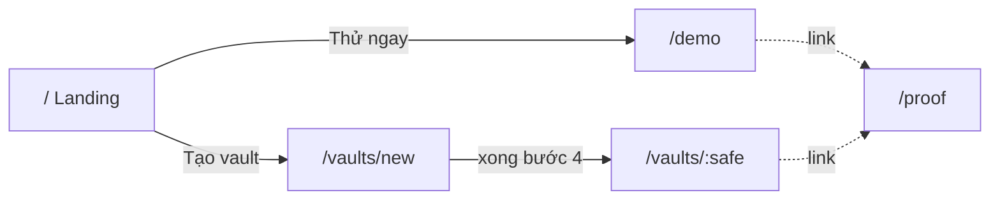
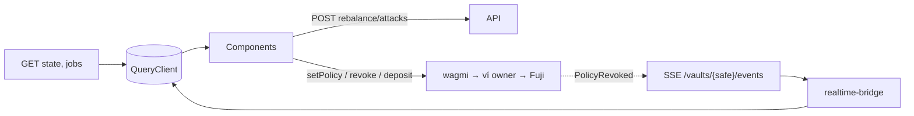

# 🖥️ AgentShield — Thiết kế các trang UI

> Bản **multi-vault** theo `plan.md` D11, D12, D15, D16. Thay cho mô tả "1 màn 3 cột" trong `codebase.md` §5 (3 cột nay là layout của `/demo` và `/vaults/:safe`). API chi tiết: [`../architecture/api.md`](../architecture/api.md). Nếu lệch, `system-design.md` thắng.
>
> **Giao diện (màu, chữ, bóng, component) bắt buộc theo [`design-system.md`](./design-system.md).** File này chỉ mô tả trang và hành vi.
>
> Bất biến: Kill-Switch và `setPolicy` ký bằng ví owner **ngay trong browser** (P2); tiền luôn là string base units, format chỉ ở UI (P5); LLM chỉ viết `messageVi` (P3).

---

## 1. Sơ đồ trang

| Route | Trang | Quyền | Owner task | API chính | Ví ký |
|---|---|---|---|---|---|
| `/` | Landing + How it works | public | Q11 | `GET /proof` (số liệu nhỏ, tuỳ chọn) | không |
| `/signin`, `/signup` | Cổng truy cập: đăng nhập/đăng ký bằng ví (SIWE), form email chỉ là UI | public | A9 (nối thật) | `/auth/*` (chưa nối, đang giả lập) | ký thông điệp SIWE (không gas) |
| `/demo` | Demo vault (sandbox) | public, **không cần đăng nhập** (throttle IP, D12) | Q9, Q10, Q11 | state, jobs, rebalance, attacks, SSE | owner demo: setPolicy/Kill |
| `/vaults/new` | Wizard tạo vault | ví kết nối | L9 | `GET /vaults/{safe}` (poll đến khi indexer thấy) | create Safe, enableModule, setPolicy, faucet, deposit |
| `/vaults/:safe` | Dashboard vault | public đọc; owner thao tác | L7, L8, Q9 | như `/demo` + auth | setPolicy, revoke, deposit, withdraw |
| `/proof` | Bằng chứng on-chain | public | L9 | `GET /proof` | không |

Không có route `/admin` (D16): admin là **drawer** trong dashboard, chỉ hiện với role `admin` (§7).

`/demo` thực chất là `/vaults/:demoSafe` với: khách vãng lai thao tác được, rebalancer tắt (D15), guided tour bật, rate limit chặt. Dùng **chung một component `VaultDashboard`**, khác nhau ở prop `mode: "demo" | "owner"`.

**Hai vault demo (D15):** vault *công khai* (`/demo`, maxPerTx 500, dailyCap 1.500, cooldown để khó cạn) và vault *sân khấu* do nhóm dùng khi diễn trực tiếp, reset ngay trước giờ diễn. Vault sân khấu truy cập bằng `/vaults/:safe` như vault thường.



---

## 2. App shell (mọi trang)

```
┌──────────────────────────────────────────────────────────────────────┐
│ 🛡 AgentShield   Demo  Tạo vault  Proof     ● Live   [Fuji] [0x12..ab ▾]│
└──────────────────────────────────────────────────────────────────────┘
```

| Thành phần | Mô tả |
|---|---|
| Nav | Demo · Tạo vault · Proof; `Vault của tôi` hiện khi có vault owner |
| Badge SSE | `● Live` (xanh) / `● Đang nối lại` (vàng) / `● Offline` (xám). Reconnect → refetch snapshot |
| Network guard | Sai chain → banner "Chuyển sang Avalanche Fuji" + nút `switchChain` |
| ConnectButton | RainbowKit; Core + MetaMask. Nút `Đăng nhập` (SIWE) chỉ cần khi owner thao tác API vault của mình hoặc admin; **khách ở `/demo` không cần ví** |
| Toast | Thành công/thất bại tx, 429 cooldown |
| Footer | Link repo, Snowtrace, `/proof` |

Responsive ≥ 375px: 3 cột → xếp dọc theo thứ tự Policy → Vault → Activity → Red-team (xem §4).

---

## 3. `/` Landing

**Mục đích:** người lạ hiểu sản phẩm trong ~30s (Q11), bấm vào demo.

```
┌ Hero ──────────────────────────────────────────────────────┐
│ "AI trade giúp bạn 24/7, nhưng không thể lấy tiền"           │
│ [Thử demo ngay]  [Tạo vault của bạn]                         │
├ Hai lớp khiên ────────────────────────────────────────────┤
│ Shield 1 (AI Auditor, off-chain) → Shield 2 (Contract)       │
├ 4 đòn tấn công thật ─ 4 thẻ: Over-withdraw · Wrong recipient │
│                       · Unlimited approval · Bypass website  │
├ Kill-Switch ─ "Tắt server đi, nút Kill vẫn chạy" (~1,5s)     │
├ Số liệu Fuji ─ finality · fuzz 10k runs · contract verified  │
└ Footer ───────────────────────────────────────────────────┘
```

- **Component:** `features/landing/{Hero,TwoShields,AttackCards,Stats}`.
- **API:** `GET /proof` cho dải số liệu; lỗi → ẩn dải, không chặn trang.
- **Trạng thái:** chỉ tĩnh; không cần ví.

---

## 4. `/demo` và `/vaults/:safe` — Dashboard

### 4.1 Layout (desktop ≥ 1024px)

```
┌ VaultHeader: 0xSafe..  [● Active]  Agent: 0xAgent..  [Snowtrace ↗] ─┐
├─────────────────┬────────────────────────────┬────────────────────┤
│ CỘT 1: Owner    │ CỘT 2: Vault & Activity   │ CỘT 3: Red-team    │
│                 │                            │                    │
│ PolicyStatus    │ BalancesBeforeAfter        │ RunRebalanceButton │
│  maxPerTx 500   │  USDC 3,000 → 2,800        │  [Run 200 USDC]    │
│  dailyCap 1,500 │  WAVAX 10  → 10.9          │                    │
│  expiry         │                            │ AttackButtons      │
│                 │ DailyBudgetBar             │  #1 Over-withdraw  │
│ PolicyForm      │  ████░░░░ 200 / 1,500      │  #2 Wrong recipient│
│ (owner only)    │                            │  #3 Unlimited appr.│
│                 │ JobTimeline + ExplanationCard │ #4 Bypass ⚡    │
│ [ KILL-SWITCH ] │  precheck→sim→invariant→   │                    │
│  (owner only)   │  chain  · badge llm|template│ InjectionBox      │
│                 │  [Snowtrace ↗]             │                    │
│ DepositWithdraw │ JobHistory (list)          │                    │
└─────────────────┴────────────────────────────┴────────────────────┘
```

Mobile (<1024px): xếp dọc 1 → 2 → 3, `KillSwitch` luôn dính đáy màn hình khi là owner.

### 4.2 Component ↔ nguồn dữ liệu

| Component (`features/…`) | Dữ liệu | Nguồn |
|---|---|---|
| `vault/VaultHeader` | địa chỉ, `isActive`, agent | `GET /vaults/{safe}` + `chain.revoked`/`chain.policy` |
| `policy/PolicyStatus` | limits theo token, expiry, epoch | wagmi `useReadContract` (chain trực tiếp) **hoặc** `state.policy` |
| `policy/PolicyForm` | form `maxPerTx`, `dailyCap`, `expiry` (schema từ `shared`) | wagmi write `setPolicy` — **không qua backend** |
| `kill-switch/KillSwitchButton` | độ trễ đo được | wagmi write `revoke`; hiển thị "Đã khoá sau X,Y giây" |
| `vault/BalancesBeforeAfter` | balances trước/sau job gần nhất | `state.balances` + `job.sim` |
| `vault/DailyBudgetBar` | `spentToday / dailyCap`, `budgetUsedPct` | `state.spentToday` (chain), cập nhật bởi `chain.swap` |
| `vault/DepositWithdraw` | nạp/rút Safe | wagmi: ERC20 transfer / Safe tx (owner) |
| `activity/JobTimeline` | các bước Shield 1 → Shield 2 | `GET /jobs/{id}` + `job.updated` |
| `activity/ExplanationCard` | `messageVi`, `source`, `verdict` | `job.explained` |
| `activity/JobHistory` | danh sách job | `GET /vaults/{safe}/jobs` + SSE |
| `red-team/RunRebalanceButton` | — | `POST /vaults/{safe}/jobs` |
| `red-team/AttackButtons` | — | `POST /vaults/{safe}/attacks` |
| `red-team/InjectionBox` | text | `POST /vaults/{safe}/attacks` (prompt-injection) |

### 4.3 Quyền và trạng thái nút

| Phần tử | Khách (không đăng nhập) | Owner (SIWE + on-chain) | Admin (SIWE + allowlist) |
|---|---|---|---|
| Xem state, job, SSE | ✅ | ✅ | ✅ |
| Run Rebalance, 4 đòn, injection | ✅ *chỉ vault demo công khai* (throttle IP + cooldown) | ✅ vault của mình | ✅ |
| PolicyForm, Kill, Deposit/Withdraw | ẩn | ✅ (ký ví, không qua backend) | ẩn nếu không là owner |
| Drawer admin (Demo mode, Bull Board, gas agent) | ẩn | ẩn | ✅ |

Owner được xác định **on-chain** (`Safe.getOwners`), backend chỉ kiểm lại để cấp cookie role.

### 4.4 Các trạng thái đặc biệt

| Tình huống | UI |
|---|---|
| `state.stale = true` (RPC lỗi) | Badge vàng "Dữ liệu cũ", giữ số cuối, tự thử lại |
| `isActive = false` (sau Kill) | Header đỏ 🔴, nút attack/rebalance vẫn bấm được và nhận `PolicyInactive` (đó là demo); PolicyForm hiện nút `Kích hoạt lại` (setPolicy mới → epoch mới, D10) |
| Hết budget ngày (demo, D15) | Banner "Shield 2 đang chặn: đã dùng hết hạn mức ngày"; không phải lỗi |
| Agent sắp hết gas | Chặn Run/attack, thông báo "Agent thiếu gas, thử lại sau" (A9) |
| HTTP 429 | Toast + đếm ngược cooldown theo vault |
| HTTP 403 (không phải owner) | Ẩn control owner, giữ read-only |
| Job `failed` (hạ tầng) | Thẻ xám "Lỗi hạ tầng, thử lại"; **không** auto-retry revert |
| Giải thích đến muộn | Thẻ job hiện ngay với skeleton ở dòng giải thích; `job.explained` điền sau, không nhảy layout |
| Gemini lỗi | Badge `template` (tính năng, không phải lỗi) |
| SSE rớt | Badge "Đang nối lại"; sau nối lại refetch `state`, `jobs` |

### 4.5 Màu và nhãn kết quả job

| Status | Thẻ | Nhãn |
|---|---|---|
| `confirmed` | Xanh | "An toàn, tiêu 13,3% hạn mức ngày" |
| `rejected` | Đỏ | "Shield 1 chặn" + reason code |
| `reverted` | Đỏ đậm + link Snowtrace | "Shield 2 chặn trên chain" |
| `failed` | Xám | "Lỗi hạ tầng" |
| `queued…broadcasting` | Xanh dương, spinner | tên bước hiện tại |

Mỗi reason code → câu tiếng Việt từ `shared/errors.ts` (Q1); UI không tự dịch.

### 4.6 Guided tour (chỉ `/demo`)

4 bước tooltip: ① Run Rebalance → ② Over-withdraw → ③ Bypass ⚡ → ④ Kill-Switch. Có `Bỏ qua`; cắt được theo kế hoạch (thay bằng hướng dẫn tĩnh).

---

## 5. `/vaults/new` — Wizard tạo vault

```
Bước:  ① Safe ─ ② Module ─ ③ Policy ─ ④ Nạp tiền ─ ✔ Xong
```

| Bước | Hành động ví | Điều kiện hoàn thành (đọc chain) |
|---|---|---|
| 1. Safe | Tạo Safe mới (Protocol Kit) hoặc chọn Safe đã có mà ví là owner | `Safe.isOwner(ví)` |
| 2. Module | Factory `createModule` + Safe `enableModule` | `Safe.isModuleEnabled(module)`; sự kiện `ModuleDeployed` |
| 3. Policy | Form policy → `setPolicy` | `isActive = true` |
| 4. Nạp tiền | `faucet` MockUSDC (có cooldown) → transfer vào Safe | balance Safe > 0 |

- **Resume:** tiến trình suy ra từ **chain** (không lưu trong DB, P1); lưu `safe` đang làm ở `localStorage` để đóng tab mở lại vẫn tiếp tục.
- **Sau bước 2:** poll `GET /vaults/{safe}` (≤ 5s theo A8) đến khi indexer đăng ký; nếu quá hạn có nút `Đăng ký thủ công` → `PUT /vaults/{safe}`.
- **Lỗi:** user từ chối ký → giữ nguyên bước; tx revert → hiện reason code; faucet cooldown → đếm ngược.
- Mục tiêu: ví mới tạo xong < 3 phút.

---

## 6. `/proof` — Bằng chứng

| Khối | Nội dung | Nguồn |
|---|---|---|
| Contracts | Module, Factory, MockUSDC, Safe demo: địa chỉ + `Verified ✓` + link Snowtrace | `GET /proof.contracts` |
| Finality | Thời gian Kill đo được: trung bình/min/max, 10 lần gần nhất | `GET /proof.finality` (từ `chain.revoked.latencyMs`) |
| Tests | fuzz 10,000 runs, invariant (3), Slither summary | `GET /proof.tests` |
| Tx đã chặn | Danh sách tx revert đòn #4 (`ExceedsPerTxCap`) có link | `GET /proof.blockedTxs` |
| Giới hạn đã biết | Cap theo đơn vị token, `minOut` do agent gửi, chỉ testnet (nói trung thực) | tĩnh |

Chỉ đọc; không cần ví.

---

## 7. Drawer Admin (D16)

Không phải route riêng. Nút "Admin" ở app shell chỉ hiện khi session có role `admin`; mở drawer trên `/demo` hoặc `/vaults/:safe`: trạng thái rebalancer, `Pause/Resume` (Demo mode), link Bull Board, `/api/health`, số dư gas của agent. Lý do: admin cần bật Demo mode ngay lúc đứng ở dashboard khi trình diễn.

---

## 8. Luồng dữ liệu & quy ước

**Snapshot + stream** (không đảm bảo delivery):



- Mở **1 EventSource** mỗi vault đang xem, đóng khi rời trang.
- `ServerEvent` sai schema → bỏ, log; không crash.
- Query keys: `["vault", safe, "state"]`, `["vault", safe, "jobs"]`, `["job", id]`.
- Số tiền: `bigint` ↔ string; format bằng `shared/money`; **cấm** `Number()` trên số tiền.
- Luật FE: feature không import feature khác; chia sẻ qua `shared/`.

### Component dùng chung

| Component | Dùng ở |
|---|---|
| `SnowtraceLink` | dashboard, proof, toast |
| `AddressChip` (copy, rút gọn) | mọi trang |
| `TokenAmount` (bigint → hiển thị) | dashboard, wizard |
| `StatusBadge` (job/vault) | dashboard |
| `ExplanationCard` | dashboard |
| `TxButton` (state pending/confirmed/error, đo thời gian) | Kill, setPolicy, wizard |

---

## 9. Ma trận Trang ↔ API ↔ SSE

| Trang | REST | SSE event |
|---|---|---|
| `/` | `GET /proof` | — |
| `/demo`, `/vaults/:safe` | `GET /vaults/{safe}`, `GET /vaults/{safe}/state`, `GET /vaults/{safe}/jobs`, `GET /jobs/{id}`, `POST /vaults/{safe}/jobs`, `POST /vaults/{safe}/attacks`, auth (`/auth/*`) | `job.updated`, `job.explained`, `chain.swap`, `chain.policy`, `chain.revoked` |
| `/vaults/new` | `GET /vaults/{safe}`, `PUT /vaults/{safe}`, auth | `vault.registered` *(tuỳ chọn)* |
| `/proof` | `GET /proof` | — |
| Drawer Admin (trong dashboard) | `GET/PATCH /admin/rebalancer`, `GET /admin/queues`, `GET /api/health` | — |
| Danh sách vault (menu) | `GET /vaults` | — |
